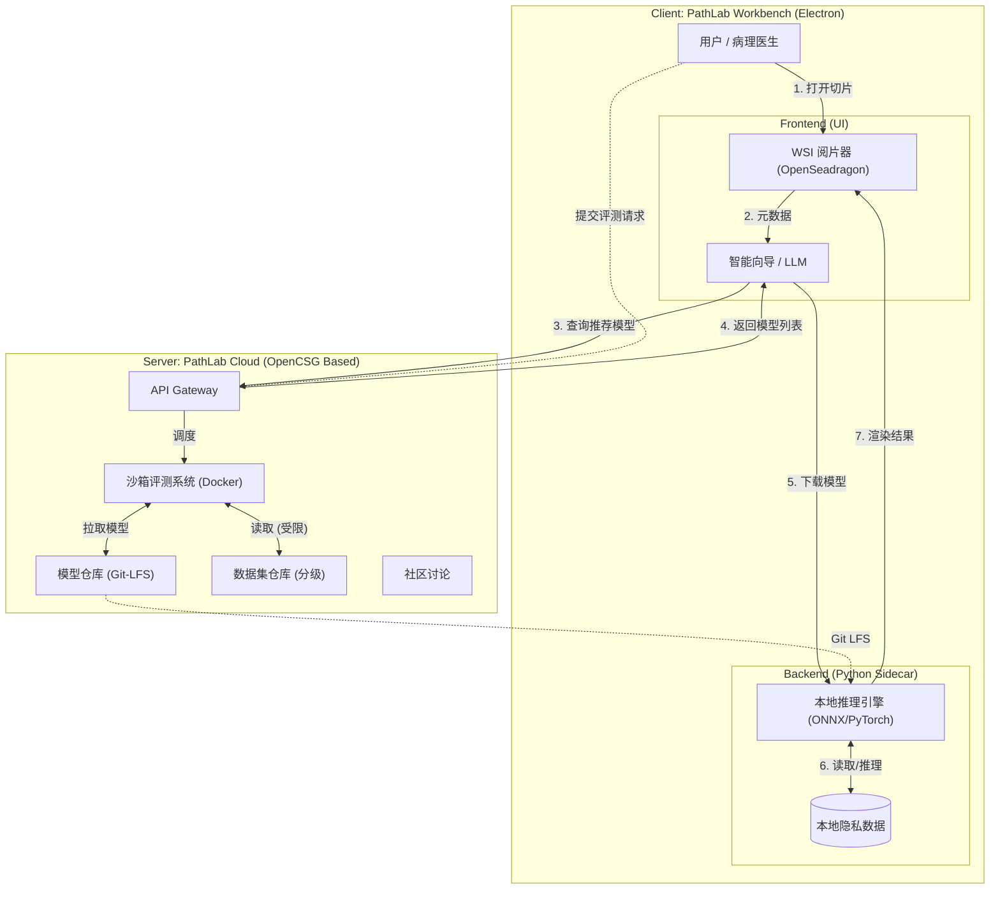

# PathLab

## 产品需求规格说明书 (PRD)

> **项目名称:** PathLab
> **版本:** v1.0
> **日期:** 2026-01
> **状态:** ✅ Phase 1 已完成原型 (Prototype Complete)
> **核心愿景:** 构建病理领域的 "Hugging Face"，实现“数据不动，模型动”的隐私计算生态。

---

## 🎯 当前实现进度 (Implementation Status)

### ✅ 已完成功能 (Phase 1 - Prototype)

#### Client 端 (pathlab-client)
| 功能模块 | 状态 | 说明 |
|---------|------|------|
| 登录认证系统 | ✅ | OAuth 集成 PathLab Server，支持 Demo 测试账户 |
| 欢迎登录页 | ✅ | 现代化深色渐变设计，功能卡片展示 |
| Electron + Python 双进程架构 | ✅ | 主进程管理 Python Sidecar 生命周期，动态端口发现 |
| WSI 阅片器 | ✅ | 基于 OpenSeadragon 的多层级 WSI 可视化 |
| AI Chat 智能助手 | ✅ | 流式 LLM 对话，自动提取任务参数 (PathLab Agent) |
| WSI 上传与管理 | ✅ | 支持批量 CSV 导入、元数据管理（含患者信息） |
| 训练任务系统 | ✅ | ResNet50 特征提取 + ABMIL 训练，特征缓存复用 |
| 推理分析系统 | ✅ | WSI 分类、注意力热图可视化 |
| 模型管理 | ✅ | 训练模型保存、加载、默认模型切换 |
| 报告生成 | ✅ | AI 分析报告自动生成 |
| SQLite 数据库 | ✅ | 零配置，完整的 ORM 模型和 Repository 模式 |
| 存储管理系统 | ✅ | 文件生命周期管理、级联删除、存储统计 |
| 工具页面 | ✅ | 集成实用工具（如论文信息提取） |

#### TODO
- [x] 切片和任务存储管理
- [x] Results Viewer 实现
- [x] 决定 Slide Viewer 显示的信息
- [x] 防止用户调太大 bs 的时候系统能正确抛出错误不崩 允许用户重跑失败任务 rerun 逻辑修正
- [x] 队列任务处理，支持断电等意外情况恢复原状态
- [x] External Validation & 复用目前的模型重新推理 - 待测试
- [x] 队列逻辑，系统稳定性逻辑 - 待测试
- [x] 支持 patch-level classification, wsi-level survival analysis，上传逻辑重写 - 待测试
- [ ] Agent
- [ ] 客户端打包
- [ ] 服务端用户管理，安全性打包

#### 技术架构
```
pathlab-client/
├── src/                      # Electron 前端 (React + TypeScript)
│   ├── main/                 # 主进程 (窗口管理、Sidecar 管理)
│   │   ├── index.ts          # 入口点
│   │   └── sidecar-manager.ts # Python 进程管理 + 动态端口发现
│   ├── preload/              # Preload 脚本
│   │   └── index.ts          # Backend API 暴露
│   └── renderer/             # 渲染进程 (React 应用)
│       └── src/
│           ├── pages/            # 页面组件
│           │   ├── LoginPage.tsx     # 登录欢迎页 (默认首页)
│           │   ├── DashboardPage.tsx # 仪表盘
│           │   ├── AIChatPage.tsx    # AI 智能助手 (PathLab Agent)
│           │   └── ...               # 其他功能页面
│           ├── components/       # 可复用组件
│           │   ├── Layout.tsx        # 主布局 (侧边栏、用户信息、退出)
│           │   └── WSIViewer.tsx     # OpenSeadragon 封装
│           └── contexts/         # React Context
│               └── AuthContext.tsx   # 认证状态管理
│
└── server/                   # Python 后端 (FastAPI)
    ├── main.py               # 统一入口 (动态端口发现)
    ├── gateway/              # API 网关 (动态端口)
    │   ├── main.py           # Gateway FastAPI 应用
    │   └── routes/           # 模块化路由
    │       ├── auth.py           # OAuth 认证路由
    │       ├── wsi.py            # WSI 管理
    │       ├── chat.py           # AI Chat
    │       ├── training.py       # 训练任务
    │       └── storage.py        # 存储管理
    └── backend/              # 核心服务
        ├── ai/               # AI 推理与训练 (内部端口)
        ├── preprocessing/    # WSI 预处理 (内部端口)
        ├── database/         # SQLite ORM (零配置)
        │   ├── database.py       # 异步 SQLite 连接
        │   ├── models.py         # 数据模型
        │   └── repositories.py   # 数据访问层
        ├── storage/          # 文件存储管理
        └── common/           # 公共模块
            ├── port_utils.py     # 端口发现工具
            └── auth.py           # 认证模块
```

#### 服务端口
| 服务 | 端口 | 职责 |
|------|------|------|
| Gateway | 动态分配 | API 网关、业务编排、Chat、OAuth 认证 |
| Preprocessing | 内部端口 | WSI 切片、DZI 生成、缩略图 |
| AI | 内部端口 | 特征提取、模型训练、推理 |
| SQLite | 内嵌数据库 | 数据持久化 (零配置) |

**注意**: Python 后端启动时自动寻找可用端口，通过 `PORT=xxxxx` 输出通知 Electron。

#### 页面路由
| 路由 | 页面 | 说明 |
|------|------|------|
| `/` `/login` | LoginPage | 登录欢迎页 (默认首页) |
| `/dashboard` | DashboardPage | 仪表盘概览 |
| `/ai-chat` | AIChatPage | PathLab Agent 智能助手 |
| `/tools` | ToolsPage | 实用工具集 |
| `/task-setup` | NewTaskPage | 手动任务配置 |
| `/task-list` | TaskListPage | 任务浏览器 |
| `/task/:task_id` | TaskDetailPage | 任务详情页 |
| `/wsi-list` | ListPage | 切片浏览器 |
| `/wsi/:wsi_id` | DetailPage | WSI 阅片器 (全屏) |
| `/register` | UploadPage | 注册切片 |
| `/results` | ResultsViewerPage | 结果查看器 |
| `/reports` | ReportGeneratorPage | 报告生成器 |
| `/settings` | SettingsPage | 系统设置 |

### 🚧 规划中功能 (Phase 2 - MVP)
- [ ] Server 端 (OpenCSG 二开) 模型托管
- [ ] Wizard 模型推荐系统
- [ ] Public 数据集支持
- [ ] 完整 OAuth 认证流程 (取代 Demo 登录)

### 📋 未来规划 (Phase 3 - Beta)
- [ ] Level 2 沙箱评测系统
- [ ] Leaderboard 排行榜
- [ ] 多用户权限管理

---

## 1. 项目背景与愿景 (Vision)

### 1.1 痛点分析
1.  **模型碎片化:** 病理 AI 模型分散在 GitHub 各处，缺乏统一的输入输出标准（倍率、切块大小不一）。
2.  **部署门槛高:** 医生无法使用复杂的 Python 脚本，缺乏“傻瓜式”的本地推理工具。
3.  **数据隐私壁垒:** 医疗数据（WSI）敏感度极高，无法上传至公有云，导致“数据孤岛”现象严重，限制了模型的大规模验证。

### 1.2 解决方案
**PathLab** 采用 **"中心化分发 + 去中心化推理"** 的混合架构：
* **Server (Cloud):** 基于 OpenCSG 二次开发，负责模型托管、版本管理、元数据索引及**受限沙箱评测**。
* **Client (Local):** 基于 Electron + Python 开发，提供智能向导 (Wizard) 和可视化阅片，确保原始切片数据**不出本地**。

---

## 2. 系统架构设计 (System Architecture)

### 2.1 架构拓扑图



### 2.2 核心技术栈
- Server: OpenCSG / CSGHub (Go/Python), PostgreSQL, MinIO (S3), Docker, Redis.

- Client: Electron (React/Vue), Python (FastAPI), ONNX Runtime, OpenSeadragon.

---

## 3. 功能需求详述 (Functional Requirements)

### 3.1 Server 端 (The Hub)

ID | 模块 | 功能点 | 详细描述 | 优先级
---|------|--------|----------|-------
S-01 | 模型仓库 | Git-LFS 托管 | 支持大文件模型权重存储，支持版本 Tag 管理。 | P0
S-02 | 模型仓库 | 元数据解析 | 强制解析 model_config.json，在 UI 展示适用倍率、染色类型等。 | P0
S-03 | 数据仓库 | 隐私分级 | 实现 Public (公开), Restricted (受限/盲测), Private (私有) 三级权限。 | P0
S-04 | 评测系统 | 沙箱评测 (Level 2) | 在断网 Docker 中运行用户代码测试 Restricted 数据，仅返回 Metrics。 | P1
S-05 | 评测系统 | Leaderboard | 针对特定任务（如乳腺癌淋巴结转移）生成模型性能排行榜。 | P1
S-06 | 社区 | 讨论版 | 支持针对模型/数据集的 Issue 讨论与 Star/Fork 社交功能。 | P2

### 3.2 Client 端 (The Workbench)

ID | 模块 | 功能点 | 详细描述 | 优先级
---|------|--------|----------|-------
C-01 | 基础架构 | 双进程守护 | Electron 主进程管理 Python 子进程生命周期，自动处理环境依赖。 | P0
C-02 | 阅片器 | WSI 可视化 | 支持 SVS, NDPI, TIFF 等格式，支持平滑缩放与多层级浏览。 | P0
C-03 | 向导 | 智能推荐 | 根据打开的切片信息（部位、染色），自动从 Server 检索匹配模型。 | P0
C-04 | 推理引擎 | 本地推理 | 下载模型到本地缓存，对当前视野或全片进行预测，保护数据隐私。 | P0
C-05 | 可视化结果 | 叠加 | 将推理结果（Mask/Heatmap）以图层形式叠加在 WSI 上，支持透明度调节。 | P0
C-06 | 交互 | LLM 助手(可选) | 集成对话框，允许用户通过自然语言指令调用模型。 | P2

---

## 4. 数据隐私与安全策略 (Data Privacy Strategy)

PathLab 的核心差异化在于对 Restricted (Level 2) 数据的处理。

### 4.1 隐私分级矩阵

等级 | 名称 | 适用场景 | 数据可见性 | 模型执行位置
-----|------|----------|------------|--------------
Level 1 | Public | 教学、公共竞赛 | 全员可下载 | 用户本地 / 云端
Level 2 | Restricted | 科研合作、多中心验证 | 不可下载 (Code-to-Data) | Server 端沙箱 (无网容器)
Level 3 | Private | 医院临床数据 | 仅 Owner 可见 | Client 端本地 (数据不上云)

### 4.2 沙箱安全机制 (针对 Level 2)

- **网络阻断:** 评测容器禁用所有 Outbound 网络连接。  
- **日志清洗:** 拦截 stdout/stderr，限制输出长度，防止通过日志打印像素数据。  
- **临时存储:** 容器销毁后，除 metrics.json 外的所有临时文件立即清除。

---

## 5. 接口与标准化 (Standards)

### 5.1 模型配置文件标准 (model_config.json)

为了实现 Client 端的“傻瓜式”调用，所有模型必须包含此文件。

```json
{
  "version": "1.0",
  "meta": {
    "name": "PathLab-Unified-Model",
    "framework": "pytorch"
  },

  // 输入标准：不管是哪种任务，Client 第一步都是切图
  "input": {
    "mpp": 0.5,
    "patch_size": [512, 512],
    "normalization": "macenko"
  },

  // 任务定义：开发者只需从以下三种模板里选一种
  "tasks": [
    
    // --- 类型 1: Patch Classification (图块分类) ---
    // 场景：判断这一小块是肿瘤还是正常
    // Client 行为：循环推理 -> 取最大概率类别 -> 在该 Patch 位置画一个半透明方块
    {
      "name": "Tumor Detection (Tile Level)",
      "type": "classification", 
      "tensor_index": 0,         // 输出是向量 [0.1, 0.9]
      "classes": [
        { "label": 0, "name": "Normal", "color": null },      // 正常不染色
        { "label": 1, "name": "Tumor",  "color": "#FF0000" }  // 肿瘤染成红色方块
      ]
    },

    // --- 类型 2: Patch Segmentation (像素分割) ---
    // 场景：精确勾勒肿瘤边界
    // Client 行为：循环推理 -> 获取 Mask -> 在 Patch 上进行像素级叠加
    {
      "name": "Nuclei Segmentation",
      "type": "segmentation",
      "tensor_index": 0,         // 输出是 Mask 图片 [512, 512]
      "classes": [
        { "label": 0, "name": "Background", "color": null },
        { "label": 1, "name": "Nuclei",     "color": "#0000FF" } // 细胞核染蓝
      ]
    },

    // --- 类型 3: WSI Classification (全片 MIL) ---
    // 场景：直接给这张片子下诊断，并给出热力图
    // Client 行为：提取全片特征 -> 喂入 Bag -> 显示诊断 -> 映射 Attention 权重
    {
      "name": "Slide Diagnosis",
      "type": "wsi",
      
      // 主输出：诊断结果
      "tensor_index": 0,         // 输出是全片概率
      "classes": [
        { "label": 0, "name": "Benign" },
        { "label": 1, "name": "Malignant" }
      ],

      // 辅助输出：热力图 (Attention Map)
      "attention": {
        "enabled": true,
        "tensor_index": 1,       // 输出是 Attention 权重向量
        "colormap": "jet",       // 渲染风格
        "opacity": 0.5
      }
    }
  ]
}
```

### 5.2 Client-Sidecar 通信协议

Electron (Frontend) 调用 Python (Backend) 的本地接口示例。

**Endpoint:** `POST http://localhost:PORT/inference`  

**Payload:**

```json
{
  "model_path": "cache/models/user_a/model_b",
  "wsi_file": "/Users/docs/slide_001.svs",
  "region": { "x": 1000, "y": 2000, "w": 1024, "h": 1024 }
}
```

---

## 6. 开发路线图 (Roadmap)

### Phase 1: 原型 (Prototype) - 1个月

**目标:** 跑通全流程，验证技术可行性。  

**任务:**

- 部署基础版 OpenCSG。
- Electron 实现打开本地 SVS 文件。
- Electron 调用 Python 脚本运行一个硬编码的 ResNet 模型。

### Phase 2: MVP (Minimum Viable Product) - 3个月

**目标:** 实现核心功能，发布内测版。  

**任务:**

- 定义并冻结 model_config.json。
- 实现 Client 端模型自动下载与版本管理。
- 实现 Wizard 基础推荐逻辑。
- Server 端支持 Public 数据集。

### Phase 3: 增强与生态 (Beta) - 6个月

**目标:** 完善隐私计算与社区功能。  

**任务:**

- 上线 Level 2 沙箱评测系统。
- 上线 Leaderboard。
- 集成 LLM 对话接口。


## 7. 目录结构

### 主文件夹
```bash
pathlab/
├── 📂 spec/                   # [核心契约] Client 和 Server 共用的标准
│   ├── model_config.schema.json  # 定义 model_config.json 的 JSON Schema
│   └── api_contract.yaml         # 定义 API 接口 (OpenAPI/Swagger)
│
├── 📂 pathlab-client/      # [桌面端] Electron + Python
│   ├── package.json
│   ├── electron-builder.yml   # 打包配置 (关键：如何把 Python 打包进去)
│   ├── src/                   # Electron 源码 (TS/JS)
│   └── server/                # Python Sidecar 源码 (FastAPI/PyTorch)
│
├── 📂 pathlab-server/      # [服务端] OpenCSG Fork/二开 (规划中)
│   ├── go.mod / requirements.txt
│   └── cmd/
│
└── 📄 README.md
```

---

### Client 端 (当前实现)

```bash
pathlab-client/
├── 📂 src/                        # [Frontend] Electron + React
│   ├── 📂 main/                   # Electron 主进程
│   │   ├── index.ts               # 入口点
│   │   └── sidecar-manager.ts     # Python Sidecar 管理
│   │
│   └── 📂 renderer/               # React 渲染进程
│       └── 📂 src/
│           ├── 📂 pages/          # 页面组件
│           │   ├── LoginPage.tsx      # 登录欢迎页 (OAuth + Demo)
│           │   ├── DashboardPage.tsx  # 仪表盘
│           │   ├── AIChatPage.tsx     # PathLab Agent
│           │   ├── ListPage.tsx       # 切片浏览器
│           │   ├── DetailPage.tsx     # WSI 阅片器
│           │   └── ...
│           │
│           ├── 📂 components/     # 可复用组件
│           │   ├── Layout.tsx         # 主布局 (侧边栏、用户信息、退出)
│           │   └── WSIViewer.tsx      # OpenSeadragon 封装
│           │
│           ├── 📂 contexts/       # React Context
│           │   └── AuthContext.tsx    # 认证状态 (OAuth + Demo 登录)
│           │
│           ├── api.ts             # 后端 API 调用
│           └── App.tsx            # 路由配置
│
└── 📂 server/                     # [Backend] Python FastAPI
    ├── 📂 gateway/                # API 网关 (Port 6100)
    │   ├── main.py
    │   └── 📂 routes/
    │       ├── auth.py                # OAuth 认证
    │       ├── wsi.py                 # WSI CRUD
    │       ├── chat.py                # AI Chat (LLM)
    │       ├── training.py            # 训练任务
    │       └── storage.py             # 存储管理
    │
    └── 📂 backend/                # 核心服务
        ├── 📂 ai/                 # AI 服务 (Port 6102)
        │   └── 📂 tasks/              # ABMIL 训练、推理
        ├── 📂 preprocessing/      # 预处理 (Port 6101)
        │   └── tiling.py              # WSI 切片
        ├── 📂 database/           # PostgreSQL ORM
        │   ├── models.py
        │   └── repositories.py
        └── 📂 storage/            # 文件存储管理
            └── manager.py
└── 📄 electron-builder.yml
```

### Server 端 (规划中)

> 基于 OpenCSG 二次开发，负责模型托管、OAuth 认证、沙箱评测等云端功能。

```bash
pathlab-server/
├── 📂 cmd/server/
├── 📂 internal/
│   ├── 📂 models/             # 云端数据库模型 (PostgreSQL)
│   │   ├── user.go            # 账号信息
│   │   ├── model.go           # 模型资产
│   │   └── telemetry.go       # 客户端上报的日志表
│   │
│   ├── 📂 api/
│   │   ├── 📂 v1/
│   │   │   ├── auth.go        # OAuth 登录/注册
│   │   │   ├── market.go      # 模型市场接口
│   │   │   └── sync.go        # 处理客户端的 Pull/Push 请求
│   │
│   ├── 📂 pathology/          # 元数据解析逻辑
│   └── 📂 evaluation/         # 沙箱评测逻辑
│
└── 📄 config.yaml
```
