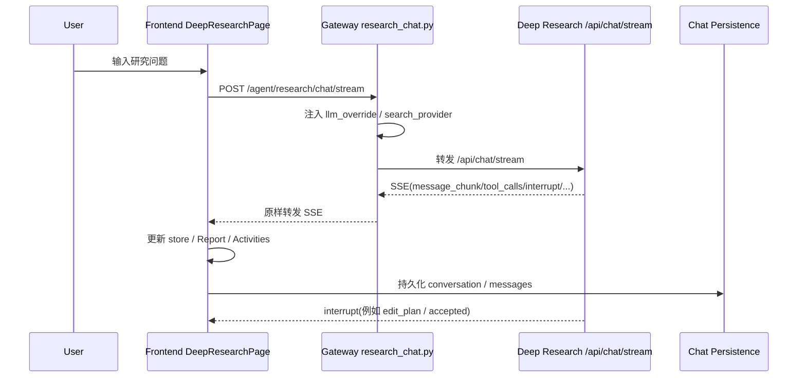
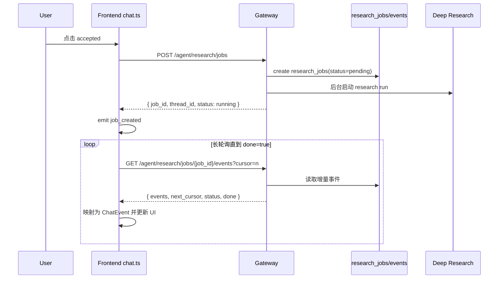
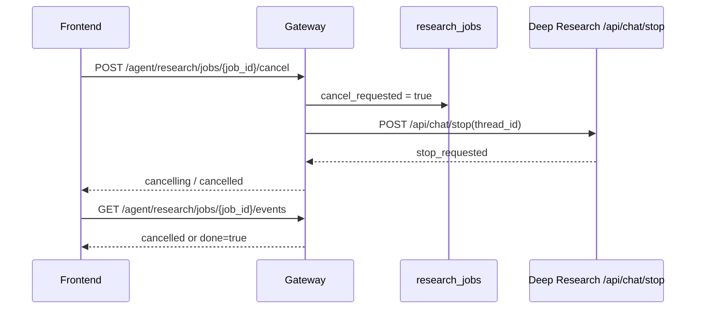

# Deep Research 集成说明

`server/backend/deep-research/` 保存的是 PathLab 当前使用的 **Deep Research vendored source snapshot**。它不是独立维护的服务仓库，而是被 PathLab 以内嵌方式接入，并由 Gateway 在 `/agent/research/*` 下对外暴露。

这份 README 关注的不是上游实现细节，而是 **PathLab 里 Deep Research 现在到底能做什么、怎么接、有哪些 API**。

## 这个目录里有什么

- `src/server/`：Deep Research HTTP 应用，核心入口包含 `/api/chat/stream`、`/api/chat/stop`、`/api/config`
- `src/graph/`：多阶段研究工作流、checkpoint、停止控制、事件流生成
- `src/pathlab/`：PathLab 适配层，用于把 PathLab 的数据集、模型、提示信息注入研究工作流
- `src/tools/`、`src/agents/`、`src/rag/`：检索、搜索、agent、RAG 等运行时能力

## PathLab 里的定位

Deep Research 在 PathLab 中不是普通聊天页的别名，而是一套单独的研究工作流，包含：

- 研究问题输入与多轮澄清
- 自动生成研究计划（plan）
- 用户对计划进行中断确认（如 `edit_plan` / `accepted`）
- 后台多步研究执行
- 实时活动流（activities）与引用（citations）回传
- 最终研究报告（report）生成
- 研究结果导出与训练对话交接

相关前端/后端入口：

- 前端页面入口：`src/renderer/src/pages/DeepResearchPage.tsx`
- 前端运行时：`src/renderer/src/lib/deep-research/`
- Gateway 代理层：`server/gateway/routes/research_chat.py`
- 研究作业持久化：`research_jobs`、`research_job_events`

## 当前功能概览

### 前端功能

根据 `src/renderer/src/pages/DeepResearch/` 与 `src/renderer/src/lib/deep-research/` 的当前实现，Deep Research 页目前具备：

- 独立研究对话页，不走普通 AI Chat 的 SSE 转换层
- 左侧消息流 + 右侧研究面板布局
- 右侧研究面板包含：
  - `Report` 标签页：显示最终研究报告
  - `Activities` 标签页：显示研究过程中的 agent/tool 活动
- 支持 citation 显示与报告内引用定位
- 支持导出研究报告为：
  - Markdown
  - HTML
  - PDF
  - Word (`.docx`)
  - Image
- 研究报告生成后，可从研究卡片发起 **Training handoff**，跳转到普通 AI Chat 并带上研究上下文

### 后端功能

Gateway + Deep Research 当前支持：

- 原始 SSE 透传（给 Deep Research 专用前端）
- 后台研究任务创建、轮询、取消、恢复查看
- 研究过程事件持久化，支持 cursor-based replay
- LLM 设置从 PathLab 全局设置注入 `llm_override`
- 搜索 provider 从 PathLab 设置同步到进程级环境
- in-process 模式与 external HTTP 服务模式双支持

## 架构与数据流

### 1. 前端如何访问 Deep Research

前端通过 `src/renderer/src/lib/deep-research/api/resolve-service-url.ts` 统一把请求映射到：

- `${API_BASE}/agent/research/chat/stream`
- `${API_BASE}/agent/research/jobs`
- `${API_BASE}/agent/research/jobs/{job_id}/events`
- `${API_BASE}/agent/research/config`

也就是说，**前端不直接请求 vendored Deep Research `/api/*`**，而是统一经过 PathLab Gateway。

### 2. Gateway 如何代理

`server/gateway/routes/research_chat.py` 当前支持两种运行方式：

- **inproc**：默认把 vendored deep-research ASGI app 以内嵌方式运行在同一个后端进程中
- **external**：如果配置 `DEEP_RESEARCH_URL`，则通过 HTTP 转发到外部 deep-research 服务

对前端来说，两种模式接口保持一致，差异由 Gateway 屏蔽。

### 3. 作业持久化如何工作

当研究流程进入后台作业模式时，Gateway 会：

1. 在 `research_jobs` 中创建一条任务记录
2. 运行 `_run_background_research_job(...)`
3. 将 deep-research SSE 事件批量写入 `research_job_events`
4. 前端通过 `cursor` 轮询 `/agent/research/jobs/{job_id}/events` 增量获取事件

这使得 Deep Research 具备：

- 页面刷新后恢复进度
- 中断后查看已产生事件
- 后台长任务的低耦合前端消费方式

## 典型调用时序

这一节描述的是 **PathLab 当前前端 + Gateway + vendored deep-research** 的真实调用链，而不是理想化设计图。

### 场景 A：用户发起一次新的 Deep Research

1. 用户在 `DeepResearchPage` 输入问题
2. 前端 `chatStream(...)` 组织请求体：
   - `messages = [{ role: "user", content: userMessage }]`
   - `thread_id`
   - `conversation_id`
   - `locale`
   - research 参数（如 `max_plan_iterations`、`enable_clarification`、`report_style`）
3. 前端调用 `POST /agent/research/chat/stream`
4. Gateway 注入：
   - `llm_override`
   - `search_provider`
   - 缺失时补齐 `thread_id`
5. Gateway 将请求转发给 vendored deep-research `/api/chat/stream`
6. deep-research 以原始 SSE 事件流返回：
   - `message_chunk`
   - `tool_calls`
   - `tool_call_result`
   - `interrupt`
   - `citations`
   - `token_usage`
7. 前端边消费事件边更新 UI 与本地 store，并把需要长期保存的消息写入 PathLab conversation

### 场景 B：计划生成后，用户点击“接受计划”

这是当前最关键的分叉点。

当前前端 `chat.ts` 的逻辑是：当 `interrupt_feedback === "accepted"` 时，优先进入**后台作业模式**。

1. 前端调用 `POST /agent/research/jobs`
2. Gateway：
   - 创建 `research_jobs`
   - 保存原始 `request_body`
   - 启动后台协程 `_run_background_research_job(...)`
3. 前端收到 `job_id` 后，先发出一个本地事件 `job_created`
4. 前端开始轮询 `GET /agent/research/jobs/{job_id}/events?cursor=0&wait_ms=15000`
5. Gateway 从 `research_job_events` 增量返回事件
6. 前端把这些事件重新映射为 `ChatEvent`，继续驱动原有 Deep Research UI
7. 当返回 `done: true` 时，轮询结束；若 `status === failed`，前端进入失败态

### 场景 C：后台作业模式不可用时的降级

如果 `POST /agent/research/jobs` 失败，前端当前不会直接报死，而是：

1. 打印警告 `Background job mode unavailable, fallback to stream`
2. 自动退回 `POST /agent/research/chat/stream`
3. 继续以前台直连 SSE 模式完成研究

这意味着当前实现是 **后台作业优先，原始 SSE 流兜底**。

### 场景 D：用户取消研究

当前有两条取消路径：

- **作业层取消**：`POST /agent/research/jobs/{job_id}/cancel`
- **线程层停止**：`POST /agent/research/chat/stop`

典型行为：

1. 若前端知道 `job_id`，优先取消后台 job
2. Gateway 会将 `cancel_requested = true`
3. 同时尝试转发停止请求到 deep-research `/api/chat/stop`
4. deep-research 在图执行层检查 stop flag，尽量以协作式方式停止
5. 前端随后在 `/events` 轮询中看到 `cancelled` 或结束态

## 前后端交互流程图

### 流程 1：首轮研究 / 计划生成



### 流程 2：接受计划后转后台作业



### 流程 3：取消后台研究



## 状态流摘要

从前端视角看，Deep Research 当前大致有这几类状态切换：

- `streaming`
  - 前台直接消费 `/chat/stream` SSE
- `interrupted`
  - 收到 `interrupt`，等待用户选择 `edit_plan` / `accepted`
- `background_running`
  - 已创建 `job_id`，通过 `/jobs/{job_id}/events` 长轮询
- `completed`
  - 报告生成完成，可导出、可 handoff 到 Training Chat
- `failed`
  - SSE `error` 或后台 job `status=failed`
- `cancelled`
  - 用户主动取消，或后台作业进入取消完成态

## 与 PathLab 业务能力的集成

`src/pathlab/api.py` 是当前的 PathLab 适配层，主要做三件事：

1. 从 PathLab API 获取业务上下文
   - `GET /wsi/datasets`
   - `GET /models`
2. 在 prompt / cache 中提供数据集、模型、特征提取器、MIL 聚合器摘要
3. 通过 `POST /api/pathlab/refresh-cache` 刷新 Deep Research 侧缓存

因此 Deep Research 在 PathLab 中并不是“通用搜索机器人”，而是能感知当前 PathLab 业务上下文的研究助手。

## PathLab 当前公开的 Deep Research API

下面列的是 **PathLab Gateway 当前实际暴露** 的 Deep Research 接口，而不是上游 deep-research 原生全部接口。

权限说明：

- 除 `GET /agent/research/health` 外，当前主要接口都依赖 Gateway 登录态（`current_active_user`）
- 作业查询与取消都会校验 `job.user_email == 当前用户邮箱`

### 1. `POST /agent/research/chat/stream`

用途：Deep Research 专用页使用的**原始 SSE 代理**。

特点：

- 请求体直接透传到 deep-research `/api/chat/stream`
- 为兼容前端演进，Gateway 使用 `await request.json()` 做宽松解析，而不是严格按固定 Pydantic 模型校验
- 会自动补充：
  - `thread_id`
  - `llm_override`
  - `search_provider`
- 当未配置可用 LLM 时，会直接返回 `event: error`

当前前端常用请求字段包括：

- `messages`
- `thread_id`
- `conversation_id`
- `resources`
- `locale`
- `auto_accepted_plan`
- `interrupt_feedback`
- `enable_clarification`
- `max_clarification_rounds`
- `max_plan_iterations`
- `max_step_num`
- `max_search_results`
- `enable_background_investigation`
- `enable_web_search`
- `enable_deep_thinking`
- `report_style`
- `mcp_settings`
- `interrupt_before_tools`

返回：`text/event-stream`

当前前端会处理的 SSE 事件类型包括：

- `message_chunk`
- `tool_calls`
- `tool_call_chunks`
- `tool_call_result`
- `interrupt`
- `citations`
- `token_usage`
- `error`
- `cancelled`

其中 `interrupt` 事件当前会附带计划阶段可选动作，如：

- `edit_plan`
- `accepted`

### 2. `POST /agent/research/jobs`

用途：创建后台研究作业。

当前前端在 `interrupt_feedback === "accepted"` 时优先尝试走这个接口。

行为：

- 创建 `research_jobs` 记录
- 立刻启动后台协程执行研究
- 返回 `job_id` 与 `thread_id`

典型返回：

- `job_id`
- `thread_id`
- `status`（当前返回 `running`）

### 3. `GET /agent/research/jobs/{job_id}`

用途：查询单个研究作业状态。

当前返回字段包括：

- `job_id`
- `thread_id`
- `status`
- `error`
- `created_at`
- `updated_at`
- `event_count`

### 4. `POST /agent/research/jobs/{job_id}/cancel`

用途：取消后台研究作业。

行为：

- 先在数据库里把 `cancel_requested` 标记为 `true`
- 再尝试转发到 deep-research `/api/chat/stop`
- 若作业已结束，则直接返回当前状态

已完成态判断：

- `completed`
- `failed`
- `cancelled`
- `interrupted`

### 5. `GET /agent/research/jobs/{job_id}/events`

用途：轮询后台研究作业事件。

查询参数：

- `cursor`：从哪个序号之后开始取，默认 `0`
- `wait_ms`：长轮询等待时间，默认 `15000`，最大 `30000`

返回结构：

- `job_id`
- `events`：事件列表，每个事件包含
  - `seq`
  - `event`
  - `data`
  - `ts`
- `next_cursor`
- `status`
- `error`
- `done`

说明：

- 若本次无新事件但任务未结束，会在 `wait_ms` 到期后返回空列表
- 若任务已结束，会返回 `done: true`
- 前端会持续轮询，并把事件重新映射为 `ChatEvent`

### 6. `GET /agent/research/jobs`

用途：列出当前用户的研究作业。

查询参数：

- `status`：逗号分隔，默认 `running,pending`

当前返回字段包括：

- `job_id`
- `conversation_id`
- `status`
- `current_stage`
- `created_at`

### 7. `GET /agent/research/conversations/{conversation_id}/job`

用途：根据 Deep Research 会话 ID 查询最近一次相关作业。

适合页面恢复、会话重入时查找最近后台任务。

### 8. `POST /agent/research/chat/stop`

用途：按 `thread_id` 直接请求停止研究流。

说明：

- 这是对 deep-research `/api/chat/stop` 的代理
- 更偏向“停止当前 thread 的运行”语义
- 而 `/jobs/{job_id}/cancel` 是 PathLab 作业层语义，二者相关但不完全等价

### 9. `GET /agent/research/health`

用途：检查 Deep Research 后端是否可达。

返回中会包含：

- `status`
- `deep_research_url`
- `mode`（`inproc` / `external`）

### 10. `GET /agent/research/config`

用途：给 Deep Research 前端 hooks 返回运行时配置。

当前前端 `useConfig()` 会消费该接口。

返回结构当前至少包含：

- `rag.provider`
- `models.basic`
- `models.reasoning`

当 deep-research 配置获取失败时，Gateway 会返回安全 fallback，而不是直接报错。

### 11. `POST /agent/research/stream`

用途：**普通 AI Chat 页** 使用的 Deep Research 兼容流，不是专用 Deep Research 页的主接口。

特点：

- 输入是 PathLab 自己的 `ChatRequest`
- Gateway 会把 deep-research SSE 重新转换成 PathLab 原有聊天页可消费的 `data: {"content": ...}` 格式
- 默认参数是“轻量 research/chat”模式：
  - `auto_accepted_plan = true`
  - `enable_background_investigation = false`
  - `enable_deep_thinking = false`
  - `enable_clarification = false`
  - `max_plan_iterations = 1`
  - `max_step_num = 3`

因此它更像 **AI Chat 与 Deep Research 之间的兼容桥**，而不是完整研究工作流入口。

## 研究事件与前端语义

前端 `src/renderer/src/lib/deep-research/api/types.ts` 当前定义了这些主要事件语义：

- `message_chunk`：流式文本输出
- `tool_calls` / `tool_call_chunks` / `tool_call_result`：工具调用过程
- `interrupt`：计划阶段中断，等待用户动作
- `citations`：引用信息
- `token_usage`：token 统计
- `error`：错误事件
- `cancelled`：取消事件
- `job_created`：后台作业已创建
- `cursor_update`：事件游标推进

这也是当前 README 中最值得记住的一点：**Deep Research 前端消费的是事件流，不是单次 JSON 响应。**

## 持久化模型

Deep Research 当前有两层持久化：

1. **会话层**：复用 `chat_conversations` / `chat_messages`
   - `conversation_type` 支持 `deep_research`
   - 前端会通过 `/conversations`、`/conversations/{id}/messages` 持久化 Deep Research 会话内容
2. **作业层**：使用 `research_jobs` / `research_job_events`
   - 保存后台研究状态与可重放事件流

### `research_jobs`

当前 `ResearchJob` 记录的关键信息包括：

- `job_id`
- `user_email`
- `conversation_id`
- `thread_id`
- `status`
- `error`
- `cancel_requested`
- `current_stage`
- `next_seq`
- `request_body`
- `created_at`
- `updated_at`

状态流说明：

- `pending`
- `running`
- `completed`
- `failed`
- `cancelled`
- `interrupted`

### `research_job_events`

`ResearchJobEvent` 用于保存可重放事件流，当前主要字段是：

- `job_id`
- `seq`
- `event_type`
- `data`
- `created_at`

## 运行与调试补充

- Electron 侧支持把前端日志追加到：`server/backend/logs/deep-research-frontend.log`
- deep-research 本体也会把统一日志写到 `server/backend/logs/pathlab.log`
- Gateway 会在启动时尝试注册 `research_chat_router`，成功后对外暴露 `/agent/research/*`

## 同步 / 升级这个 vendored snapshot 时要注意什么

这个目录不是独立真源；刷新上游代码时，至少要同时检查以下契约是否仍然成立：

- Gateway 代理接口：`server/gateway/routes/research_chat.py`
- PathLab 适配层：`src/pathlab/`
- 前端运行时：`src/renderer/src/lib/deep-research/`
- 前端页面：`src/renderer/src/pages/DeepResearch/`
- 持久化模型：`research_jobs`、`research_job_events`

典型同步流程：

```bash
mkdir -p server/backend/deep-research/src
rsync -a --delete server/.venv/lib/python*/site-packages/src/ server/backend/deep-research/src/
find server/backend/deep-research/src -type d -name '__pycache__' -prune -exec rm -rf {} +
find server/backend/deep-research/src -type f \( -name '*.pyc' -o -name '*.pyo' \) -delete
```
