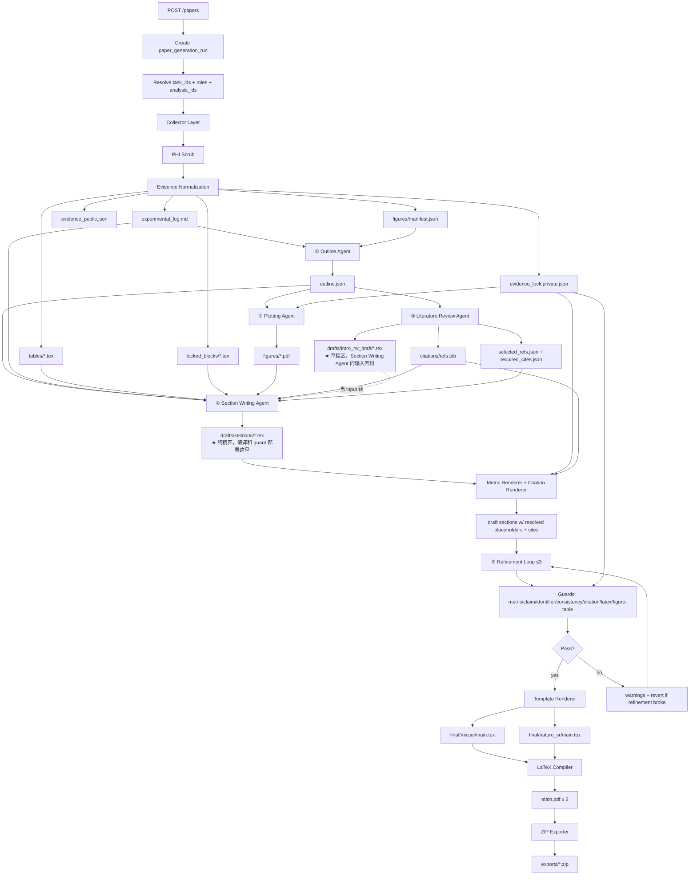

# PathLab Paper 生成 Agent 总体设计思路

> 创建日期：2026-05-04
> 最后更新：2026-05-04（Agent 设计进一步对齐 PaperOrchestra：5-agent 职责尽量 1:1 照搬；PathLab 只增强 evidence、PHI、guard 和模板层）
> 参考：`pathlab/pathlab-client/server/paper_agent/docs/research/paperorchestra.md`、`pathlab/pathlab-client/server/paper_agent/docs/research/paperorchestra_2604.05018.pdf`、`pathlab/pathlab-client/server/paper_agent/docs/research/pathlab-experiment-artifacts.md`
> 定位：基于 PathLab 已完成实验结果，自动生成论文 draft 的后端 Agent 系统。

> **目标产物（一步到位）**：给定一个或多个完成的 PathLab task，输出**两个版本**的可投稿 LaTeX + PDF：MICCAI 模板 + Nature Scientific Reports 模板。**不分阶段、不留 TODO**——下面所有特性都是 v1 范围。

## 1. 总体定位

PathLab 的 paper 生成不应该被设计成“AI 自动做研究”，而应该是 PaperOrchestra 风格的“写作自动化系统”：

- PathLab 负责完成数据管理、训练、验证、分析和可视化。
- Paper Agent 负责把这些已经存在、可追溯、可验证的材料整理成论文 draft。
- LLM 只负责组织叙事、生成段落、解释结果、生成标题/摘要/方法描述/讨论。
- 所有实验数字、数据规模、模型配置、split、图表来源都必须来自 PathLab 的数据库或运行产物。
- Agent 不能自行创造实验结果，不能重算 metric，不能编造外部验证、消融实验或统计显著性。

一句话：**PathLab Paper Agent 的核心不是“让 LLM 写得像论文”，而是把 PathLab 的实验链路变成一套带 provenance 的 paper evidence，再让 LLM 在 evidence 约束下写作。**

## 2. 设计目标

```text
输入：
  - 一个或多个已完成的 PathLab training task（可带 role tag 用于 ablation / baseline）
  - 用户撰写的 idea.md（动机、claim、研究背景）
  - 选择一个投稿模板（miccai | nature_scientific_reports；一次 paper-writing run 只按一个目标模板写作，避免 MICCAI 与 Nature section 风格混杂）

输出（每个模板各一套）：
  - manifest.json
  - experimental_log.md
  - evidence_lock.private.json（backend-only）
  - evidence_public.json
  - tables/*.tex
  - figures/*.{pdf,png}
  - drafts/sections/*.tex
  - citations/refs.bib
  - validation/{metric,claim,citation,consistency,identifier,latex,figure_table}_guard.json
  - final/{template_name}/main.tex + main.pdf
  - exports/{template_name}_bundle.zip
```

完整目标清单（**全部进 v1，不分阶段**）：

- 收集 PathLab 完整实验链路 artifact，结构化为 evidence bundle。
- 生成 PHI 脱敏的 `experimental_log.md`，作为所有事实和数字的唯一真源。
- 用 deterministic locked blocks 锁住 Method / Dataset / Results / 主表的事实内容，作为 Section Writing Agent 的工具输入。
- 用 LLM Section Writing Agent 按 PaperOrchestra 单次多模态调用生成完整 paper sections，但数字/配置只能通过 locked blocks 或占位符进入。
- Outline Agent 输出 PaperOrchestra 原始 schema：`plotting_plan` / `macro_lit_search` / `micro_lit_clusters` / `section_plan`，PathLab claim plan 只是扩展字段。
- Plotting Agent 同时生成 empirical plots 和 PaperBanana-style conceptual diagrams（Figure 1 默认走概念图子流水线）。
- Literature Review Agent 走完整 PaperOrchestra 风格链路：检索、校验、BibTeX、并起草 Introduction + Related Work。
- Content Refinement Agent 跑 AgentReview-style 评审循环，**单调收敛接受准则**，物理 snapshot/revert，最多 3 轮。
- 全部 guard enforce：metric / claim / identifier / consistency / citation / latex / figure-table。
- LaTeX 编译输出 PDF，每个模板都能直接投稿。
- 4 类 task 全支持：`wsi_classification` / `wsi_survival` / `patch_classification` / `patch_segmentation`。
- 多 task 通过 role tag 自动组织 ablation / baseline 对比表。
- 外部验证 task 自动并入主 paper 的 "Generalization to External Cohort" 段。
- Section-level regenerate API（用户改 idea 后可只重生 Introduction/Related Work，不动 locked blocks）。
- 双模板默认输出：MICCAI（LNCS）+ Nature Scientific Reports，section 顺序差异系统感知。

明确不在 v1 范围（这些是真正的"未来扩展"）：

- UI 内的可视化 section 编辑器
- 用户级 claim/table/paragraph 锁定
- 第三个及以上的 venue 模板（CVPR / Lancet / JAMA 等）
- 自定义 review rubric 编辑器

## 3. 核心原则

### 3.1 先 evidence，后 writing

Paper Agent 的第一步不是调用 LLM，而是构建 evidence bundle：

```text
PathLab DB + uploads artifacts
        │
        ▼
collector / normalizer
        │
        ▼
manifest.json + experimental_log.md + figures/tables manifest
        │
        ▼
LLM writing agents
```

如果 evidence bundle 不完整，Agent 应该提示缺少哪些材料，而不是让 LLM 补全。

### 3.2 `experimental_log.md` 是唯一事实源

PaperOrchestra 的关键输入是 experimental log。PathLab 中应该自动生成这个文件，并把它作为后续写作的 hard constraint。

`experimental_log.md` 应包含：

- 研究任务摘要。
- 数据集和 cohort 信息。
- train/val/test 或 fold split 信息。
- 预处理配置。
- 模型配置。
- 训练配置。
- 主实验结果。
- 外部验证结果。
- 定性可视化结果。
- 失败案例或限制。
- 所有图表和 metric 的来源路径。

### 3.3 LLM 不直接访问散乱运行产物

LLM 不应该直接读取数据库、日志目录、zarr bundle、analysis json。它只读取经过 collector 归一化后的材料：

- `experimental_log.md`
- `manifest.json`
- `tables/*.json` 或 `tables/*.tex`
- `figures/manifest.json`
- `references/*.bib`
- 用户补充的 `idea.md`

这样可以降低幻觉和上下文污染，并方便 validation。

### 3.4 数字必须可追溯

每一个进入论文的关键数字都应该能反查来源：

```json
{
  "metric": "macro_auc",
  "value": 0.913,
  "source_type": "analysis_summary",
  "source_path": "uploads/logs/analysis/{task_id}/{analysis_id}/summary.json",
  "task_id": "...",
  "analysis_id": "..."
}
```

后续 metric guard 可以用这个 evidence lock 检查 draft 是否：

- 改写了数字。
- 四舍五入超出允许范围。
- 引入了不存在的 metric。
- 把 validation metric 写成 test metric。
- 把内部验证结果写成外部验证结果。

### 3.5 Paper 生成走 CPU/LLM 队列

Paper 生成任务主要消耗 CPU、磁盘 IO 和 LLM API，不应该占用 GPU 训练队列。后端任务系统需要支持：

- `requires_gpu = false`
- 独立 CPU worker queue
- 可恢复的 job state
- 可中断、可重试、可查看中间 artifact

### 3.6 PHI / PII 脱敏：进 LLM 前必做

PathLab 处理的是病理数据，进入 LLM 的所有材料必须先经过脱敏，**这是合规问题（HIPAA / GDPR / 国内医疗数据规范），不是质量问题**。

需要脱敏的字段（最小集，可扩展）：

- `case_id` → 改为顺序化代号（`case_001`、`case_002`，全局映射保留在 paper run 内部）
- 患者姓名、ID、住院号 → 永远不进 prompt
- 具体日期（出生日期、手术日期、扫描日期）→ 只保留年份；`age` 字段保留没问题
- 医院 / 机构名 → 替换为 `Site_A`、`Site_B`，真值留在 evidence_lock.private.json
- 上传文件名如果含病人信息 → 重命名为 `slide_001.svs` 风格

实现要点：

- `evidence_lock.private.json` 始终保留**真值**（用于 metric guard 比对，validator 看真值）
- 进 LLM 的材料（`experimental_log.md`、`tables/*.tex`、`figures/manifest.json`）始终是**脱敏版**
- collector 输出后立刻过一道 `phi_scrub.py`，再给后续模块用
- 论文最终渲染阶段，如果用户决定在合规审查后保留某些字段，再做反向替换；否则发出去的也是脱敏版

### 3.7 Private / Public artifact 边界

`evidence_lock.private.json` 虽然是 metric guard 的事实源，但它包含真实 case_id、机构名、原始路径和 provenance，因此必须按**私有后端文件**处理，不能被普通文件下载接口和投稿 bundle 暴露。

建议物理上拆成两份：

```text
evidence/
├── evidence_lock.private.json   # 后端 validator 专用；含真值、原始 ID、原始路径、PHI 映射
└── evidence_public.json         # 前端 / 导出 / 用户预览用；只含脱敏 ID、metric key、数值和可公开 provenance
```

访问规则：

- `GET /papers/{id}/files/{path}` 使用**allowlist**，不是任意 path 透传。
- 默认允许下载：`final/`、`exports/`、`figures/`、`tables/`、`drafts/sections/`、`validation/warnings.md`、`citations/refs.bib`、`citations/coverage_report.json`、`evidence/experimental_log.md`、`evidence/evidence_public.json`。
- 默认禁止下载：`evidence_lock.private.json`、`inputs/source_tasks.json`、`inputs/source_analyses.json`、`evidence/*_summary.json` 中含原始路径/ID 的版本、`drafts/intro_rw_draft/`、原始 analysis JSON、LLM raw prompt、LLM raw response、任何日志里可能出现 PHI 的文件。
- 文件接口必须做 path normalization，拒绝 `..`、绝对路径、symlink escape、隐藏文件和未登记在 `manifest.json` 的 artifact。
- `exports/*.zip` 永远只包含 paper-facing 脱敏文件；private evidence 不进 ZIP。
- validator 在后端本地读取 `evidence_lock.private.json`，前端和 LLM 只看脱敏材料。

PaperOrchestra 没解决这个问题（它面向 ML 论文，没病人数据）。这是 PathLab 必须自己加的一层。

## 4. PathLab 完整实验后可用于写作的材料

完成训练和分析后，Paper Agent 可以收集以下材料。

### 4.1 Task 层

来自 training task：

- `task_id`
- `task_name`
- `task_description`
- `status`
- `progress`
- `group_id`
- `preprocessing_config`
- `model_config`
- `classes`
- 创建时间、开始时间、完成时间

这些材料主要用于：

- Methods 中的实验设置。
- Experiments 中的任务定义。
- Reproducibility / Implementation details。

### 4.2 Dataset / WSI 层

来自 data group、dataset、WSI slide：

- 数据集名称和来源。
- WSI 数量。
- case 数量。
- label 分布。
- age / gender / source 等 cohort 信息。
- event_time / event_status 等生存分析信息。
- mpp、vendor、magnification、宽高、文件大小等扫描信息。

这些材料主要用于：

- Dataset section。
- Cohort table。
- Train/validation/test split 描述。
- Limitation 中的数据偏倚讨论。

### 4.3 Split 层

来自 task 与 WSI 的关联表：

- train split。
- validation split。
- test split。
- cross-validation fold。
- 每个 split 的样本数、类别分布、生存事件分布。

这些材料主要用于：

- Experimental protocol。
- Data split table。
- 证明结果不是随机混用数据得到的。

### 4.4 Model 层

来自 trained model：

- `model_id`
- `model_name`
- `model_path`
- `config_path`
- `classes`
- `feature_extractor`
- `aggregator`
- `train_metrics`
- `val_metrics`

这些材料主要用于：

- Method / Implementation details。
- Model architecture description。
- Training details。
- Checkpoint provenance。

### 4.5 Analysis 层

来自 analysis output：

- `summary.json`
- `results.json`
- confusion matrix。
- ROC curve。
- loss curve。
- survival KM curve。
- segmentation mask / IoU / Dice 曲线。
- per-class metrics。
- per-sample predictions。

不同任务类型对应不同论文材料：

| 任务类型 | 可进入论文的核心结果 |
|---|---|
| Classification | accuracy、macro/micro precision、recall、specificity、F1、AUC、weighted kappa、confusion matrix、ROC |
| Survival | C-index、integrated Brier score、bootstrap CI、KM curve、risk score distribution |
| Segmentation | mIoU、Dice、pixel accuracy、precision、recall、per-class IoU/Dice、qualitative masks |

### 4.6 External Validation 层

如果用户跑过外部验证，可以收集：

- 外部数据集名称。
- 外部 cohort 信息。
- 外部 metric。
- 与内部 test set 的差异。
- 泛化能力相关图表。

这些材料是论文 claim 强弱的关键。如果没有外部验证，Agent 不能写“validated on independent external cohorts”。

### 4.7 Qualitative / Heatmap 层

来自 heatmap 和 AI result bundle：

- WSI thumbnail。
- attention heatmap。
- CAM。
- segmentation mask。
- patch-level visualization。
- representative success / failure cases。

这些材料主要用于：

- Qualitative results。
- Interpretability analysis。
- Case study figure。
- Discussion 中的 failure mode。

## 5. 总体架构

建议把后端拆成 6 层：

```text
API / Run Management
        │
        ▼
Collector Layer
        │
        ▼
Evidence Normalization Layer
        │
        ▼
Agent Writing Layer
        │
        ▼
Validation / Guard Layer
        │
        ▼
Renderer / Export Layer
```

### 5.1 API / Run Management

负责创建、查询、取消 paper generation run。

建议接口：

```text
POST   /papers
GET    /papers
GET    /papers/{paper_id}
GET    /papers/{paper_id}/files/{path}
GET    /papers/{paper_id}/export
DELETE /papers/{paper_id}
```

`GET /papers/{paper_id}/files/{path}` 不是裸文件服务器，必须走 §3.7 的 allowlist：

- 所有可下载 artifact 都必须登记在 `manifest.json`，并标注 `visibility: public | private_backend_only`。
- `private_backend_only` 文件只能被后端 validator / worker 读取，API 返回 403。
- `path` 只能是 paper run 目录内的相对路径；拒绝 `..`、绝对路径、软链逃逸和未登记路径。
- 如果用户需要调试 private evidence，只能走本机开发模式显式开关，默认产品环境禁止。

`POST /papers` 的输入可以先设计为：

```json
{
  "title": "Optional title",
  "paper_type": "research_paper",
  "language": "en",
  "source_task_ids": ["task_xxx"],
  "source_analysis_ids": ["latest"],
  "include_external_validation": true,
  "include_qualitative_examples": true,
  "target_venue": "generic",
  "user_idea": "We evaluate ...",
  "sections": [
    "abstract",
    "introduction",
    "methods",
    "experiments",
    "results",
    "discussion"
  ]
}
```

### 5.2 Collector Layer

Collector 是整个系统的事实地基，应该最先做、完全不依赖 LLM。

建议拆成：

```text
task_collector.py
  收集 task 元信息、配置、状态、classes。

dataset_collector.py
  收集 data group、dataset、WSI、cohort、label distribution。

split_collector.py
  收集 train/val/test/fold 分割。

model_collector.py
  收集 trained model、checkpoint、模型配置、train/val metrics。

analysis_collector.py
  收集 latest 或指定 analysis_id 的 summary/results/charts。

external_validation_collector.py
  收集外部验证结果。

qualitative_collector.py
  收集 heatmap、CAM、thumbnail、mask 等定性材料。
```

Collector 输出结构化 Python schema，不直接输出 prose。

### 5.3 Evidence Normalization Layer

把 collector 输出转换为稳定文件：

```text
manifest.json
experimental_log.md           # 脱敏 markdown，给 LLM 看
evidence_lock.private.json    # 真值 + provenance，后端 validator 看；不可下载/不可进 prompt
evidence_public.json          # 脱敏 evidence 摘要，前端/用户预览用
tables/*.tex                  # booktabs LaTeX 表格，直接进 draft
figures/manifest.json
```

其中：

- `manifest.json` 记录本次 paper run 的所有输入、路径、hash、状态。
- `experimental_log.md` 给 LLM 使用（**唯一进 LLM 的 markdown 文件**；其它 paper-facing 内容都是 LaTeX）。
- `evidence_lock.private.json` 给 validator 使用，保留真实 case_id / 机构 / 真值（PHI scrub 之前的版本），API / export 默认不可见。
- `evidence_public.json` 给前端和用户预览使用，只保留脱敏 identifier、metric key、数值和公开 provenance。
- `tables/*.tex` 是 booktabs 风格 LaTeX 表，直接被 `\input{}` 进 draft。
- `figures/manifest.json` 记录图片路径、caption 初稿、来源 analysis、status (ready/pending_generation/generated_by_paperbanana/requires_user_revision)。

### 5.4 Agent Writing Layer

Agent 层要**尽量 1:1 照搬 PaperOrchestra 的 5-agent 责任边界**。PathLab 的特殊能力（collector、PHI scrub、evidence lock、deterministic renderer、guard）都放在 agent 外围或作为 agent 可调用的工具，**不要把 5 个 agent 的职责改散**。

对齐原则：

- Agent 名称、顺序、并行关系保持 PaperOrchestra 原始设计：`Outline -> {Plotting || Literature Review} -> Section Writing -> Content Refinement`。
- `experimental_log.md` 仍然是唯一事实源；PathLab 只是把 PaperOrchestra 中“用户手写 log”升级为“系统自动生成 log”。
- Deterministic renderer 是 Section Writing Agent 的事实锁工具，不是第 6 个 agent，也不替代 Section Writing Agent。
- Literature Review Agent 不只生成 BibTeX，还要像 PaperOrchestra 一样起草 `Introduction + Related Work`。
- Plotting Agent 同时处理 empirical plots 和 conceptual diagrams；Figure 1 默认走 PaperBanana-style 子流水线，只有集成失败时才退化成 `requires_user_revision`。

5 个 agent 的工作分工和数据流：

```text
                              outline.json
                                   ▲
 idea + experimental_log + template│  ① Outline Agent
 + guideline + PHI-safe evidence ──┘
                                   ▼
                         ┌─────────────────────┐
                         │     outline.json    │
                         │ plotting_plan       │
                         │ macro_lit_search    │
                         │ micro_lit_clusters  │
                         │ section_plan        │
                         └──────┬──────┬───────┘
                                │      │
                     ┌──────────┘      └──────────┐
                     ▼                              ▼
            ② Plotting Agent             ③ Literature Review Agent
            empirical + conceptual       S2/PubMed verify + intro/RW draft
                     │                              │
            figures/ + captions           refs.bib + drafts/intro_rw_draft/
                     │                              │  (草稿区)
                     └──────────┬───────────────────┘
                                ▼
                   ④ Section Writing Agent
                   one multimodal call over full paper
                   locked facts via \input{} / {{m:...}}
                   intro_rw_draft 仅作 input 素材，输出全部到 sections/
                                │
                       drafts/sections/*.tex (终稿区)
                                │
                                ▼
                   ⑤ Content Refinement Agent (≤ 3 iter)
                   AgentReview-style critic + accept/revert
                                │
                                ▼
                        final/{template}/main.tex
```

#### 5.4.1 Deterministic locked blocks（Agent 的工具层，不是 Agent）

PathLab 需要比原版 PaperOrchestra 更强的事实锁。做法不是改掉 Section Writing Agent，而是在它之前生成 locked blocks，让 Section Writing Agent 只能引用或围绕这些 block 写 narrative。

```text
locked_block_renderer.py
  输入：experimental_log + evidence_lock + tables/*.tex + figures/manifest.json
  输出：
    - locked_blocks/dataset_block.tex      # cohort、split、label/event distribution
    - locked_blocks/method_block.tex       # preprocessing、model_config、training_config
    - locked_blocks/results_block.tex      # main metric、CI、per-class/per-fold summary
    - locked_blocks/external_block.tex     # 有外部验证时生成
    - tables/*.tex                         # booktabs LaTeX 表格
    - metrics_macros.tex                   # \newcommand{\TestAUC}{...} 或 {{m:...}} map
```

约束：

- locked block 里的数字、计数、配置全部来自 `evidence_lock.private.json`。
- LLM 不允许改写 locked block，只能 `\input{locked_blocks/...}` 或在文字中使用 `{{m:metric_key}}` 占位符。
- 这相当于把 PaperOrchestra 的“从 experimental log 机械抽数字”进一步工程化。

#### 5.4.2 ① Outline Agent

尽量保留 PaperOrchestra 原始 outline schema，而不是只做 PathLab claim plan。

```text
outline_agent.py
  输入：
    - idea.md
    - experimental_log.md
    - template/style.json
    - conference_guidelines.md
    - figures/manifest.json 初稿
  输出：outline.json
    {
      "plotting_plan": [
        {
          "figure_id": "fig:overview",
          "kind": "conceptual",
          "source": "idea + method_block",
          "design_objective": "show the PathLab WSI-to-prediction workflow",
          "backend": "paperbanana"
        },
        {
          "figure_id": "fig:main_results",
          "kind": "empirical",
          "source": "analysis_summary",
          "plot_spec": {...}
        }
      ],
      "macro_lit_search": [
        "whole slide image analysis computational pathology deep learning",
        "AI-assisted pathology clinical validation"
      ],
      "micro_lit_clusters": [
        {
          "cluster": "multiple instance learning for WSI",
          "queries": ["attention based multiple instance learning whole slide images", "CLAM WSI pathology"]
        },
        {
          "cluster": "task-specific clinical endpoint",
          "queries": ["... disease endpoint ..."]
        }
      ],
      "section_plan": [
        {
          "section": "Introduction",
          "goal": "motivate the clinical and computational gap",
          "citation_hints": ["WSI MIL", "computational pathology", "clinical validation"]
        },
        {
          "section": "Related Work",
          "goal": "cluster prior work by method family and clinical endpoint",
          "citation_hints": ["ABMIL", "CLAM", "TransMIL", "pathology foundation models"]
        },
        {
          "section": "Methods",
          "locked_blocks": ["locked_blocks/method_block.tex"]
        },
        {
          "section": "Experiments/Results",
          "locked_blocks": ["locked_blocks/dataset_block.tex", "locked_blocks/results_block.tex"]
        }
      ],
      "pathlab_extensions": {
        "claim_plan": [...],
        "table_plan": [...],
        "guard_requirements": ["metric", "claim", "identifier", "consistency", "citation", "latex", "figure_table"]
      }
    }
```

这里的 `macro_lit_search` / `micro_lit_clusters` / `section_plan.citation_hints` 是 PaperOrchestra 的关键，不要省略。PathLab 的 `claim_plan` 是增强字段，不能替代原始字段。

#### 5.4.3 ② Plotting Agent

Plotting Agent 按 PaperOrchestra 分成两条路径：empirical plots 和 conceptual diagrams。

```text
plotting_agent.py
  输入：outline.plotting_plan + experimental_log + evidence_lock + analysis JSON / zarr bundle
  输出：figures/*.pdf|png + figures/captions.json + figures/manifest.json

  empirical plots（确定性渲染）：
    - PathLab 已有 PNG/PDF → copy/convert → figures/
    - outline 需要但 PathLab 未产出 → 调 plotting generator：
      ├── calibration_plot.py
      ├── per_fold_roc.py
      ├── failure_cases_panel.py
      ├── km_stratified.py
      ├── heatmap_examples.py
      ├── seg_qualitative_4panel.py
      └── grad_cam_examples.py

  conceptual diagrams（PaperBanana-style）：
    - paperbanana_adapter.py
      ├── Retriever：从参考图池选结构相似的学术图
      ├── Planner：把 idea + method_block 转成详细图描述
      ├── Stylist：生成学术图风格约束
      ├── Visualizer：调用图像生成 / SVG 生成 backend
      └── Critic：VLM/LLM 检查语义、连接关系、遗漏项，最多 3 轮
    - 输出 figure_1_overview.png/pdf + caption
    - 如果 backend 不可用或 Critic 判定不可信，status = "requires_user_revision"，而不是静默通过
```

关键约束：

- empirical plot 的所有数值来自 evidence，不允许 LLM 生成像素级数字。
- LLM 可以生成 plot spec / caption，但实际绘图由确定性脚本执行。
- conceptual diagram 尽量照搬 PaperBanana 的 Retriever / Planner / Stylist / Visualizer / Critic 闭环；PathLab 只加医学合规和人工复核状态。

#### 5.4.4 ③ Literature Review Agent

Literature Review Agent 要尽量照搬 PaperOrchestra：**它不是“查 bib 工具”，而是“检索 + 验证 + 起草 Introduction / Related Work”的 agent**。

```text
literature_review_agent.py
  输入：
    - outline.macro_lit_search
    - outline.micro_lit_clusters
    - outline.section_plan[*].citation_hints
    - template/style.json
    - submission_cutoff_date
  输出：
    - citations/discovery_pool.json       # web search / API search 的原始候选池
    - citations/verified_pool.json        # 通过 S2/PubMed verification 的候选池，不等于最终都要引用
    - citations/selected_refs.json        # Literature Review Agent 选入本文的引用集合
    - citations/required_cites.json       # Section Writing Agent 必须保留的核心引用
    - citations/refs.bib                  # selected_refs 的 BibTeX；最终 paper 只用这个
    - citations/coverage_report.json
    - drafts/intro_rw_draft/introduction.tex     # ★ 草稿目录，Section Writing Agent 看完后会改写
    - drafts/intro_rw_draft/related_work.tex     # ★ 草稿目录

  流程：
    1. 对 macro_lit_search 和 micro_lit_clusters 做 10 路并发 discovery
       - PaperOrchestra 原版：Gemini Flash web search + Semantic Scholar
       - PathLab 扩展：医学/病理 query 同时查 PubMed，S2 仍是通用主链
    2. Verification chain：
       - Semantic Scholar / PubMed 命中
       - Levenshtein title similarity >= 0.7
       - publication year <= submission_cutoff_date
       - dedup by S2 paperId / DOI / PMID
    3. 生成 verified_pool：
       - 这是“可信候选池”，不是正文必须全引的集合
    4. 从 verified_pool 里选择 selected_refs：
       - 受模板 max_refs 限制（MICCAI 约 30 条，Nature SR 可更多）
       - macro 文献覆盖 Introduction，micro clusters 覆盖 Related Work
       - selected_refs 才写入 refs.bib
    5. 标出 required_cites：
       - 每个 macro/micro cluster 至少 1 篇核心引用
       - Section Writing Agent 必须保留这些 cite
       - 其它 verified_pool 候选可以不进入正文
    6. 起草 Introduction + Related Work：
       - macro 文献主要进入 Introduction
       - micro clusters 主要进入 Related Work
       - 每个 cluster 至少有代表性引用
    7. coverage gate：
       - selected_refs 里 >= 90% 必须在 intro/RW 或后续正文出现
       - required_cites 必须 100% 出现在 Section Writing Agent 的终稿 sections/
```

PathLab 可以加 PubMed，但不要改变 PaperOrchestra 的核心：**LLM 出检索意图，API 校验证据，coverage gate 防止装样子 bib**。

> **草稿 vs 终稿目录纪律**：Literature Review Agent 写到 `drafts/intro_rw_draft/`，Section Writing Agent 写到 `drafts/sections/`。**最终参与编译和 guard 校验的永远是 `drafts/sections/`**，`drafts/intro_rw_draft/` 只是 Section Writing Agent 的输入素材。这避免"两个 agent 同时写 introduction.tex 谁的版本生效"的歧义。

#### 5.4.5 ④ Section Writing Agent

Section Writing Agent 尽量保留 PaperOrchestra 的一次多模态调用方式：同时输入 outline、figures、captions、bib、experimental_log、intro/RW 草稿和 locked blocks，**生成完整 paper 的所有 section（包括 introduction 和 related_work）**。

```text
section_writing_agent.py
  输入：
    - outline.json
    - drafts/intro_rw_draft/introduction.tex   # ★ Literature Review Agent 起草，作为输入素材
    - drafts/intro_rw_draft/related_work.tex   # ★ 同上
    - citations/required_cites.json            # ★ 必须保留的核心引用
    - citations/selected_refs.json             # ★ 可引用集合
    - experimental_log.md
    - locked_blocks/*.tex
    - tables/*.tex
    - figures/*.pdf|png + captions.json
    - citations/refs.bib
    - template/style.json
  输出（全部写到 drafts/sections/，覆盖 intro_rw_draft/ 不读）：
    - drafts/sections/abstract.tex
    - drafts/sections/introduction.tex
    - drafts/sections/related_work.tex          # MICCAI 可独立章节；Nature SR 可并入 introduction
    - drafts/sections/methods.tex
    - drafts/sections/experiments.tex
    - drafts/sections/results.tex
    - drafts/sections/discussion.tex
    - drafts/sections/conclusion.tex

  写作约束：
    - 数字必须用 {{m:metric_key}} 或 locked block，不允许直接写 raw number
    - 数据集 / 模型 / 实验设置必须 \input{locked_blocks/...}，不得自由改写
    - 引用先用 [CITE:paperId]，渲染阶段替换为 \cite{paperId}
    - 每个 figure/table 必须按 outline 的 figure_id/table_id 引用
    - 不得写 task_id / case_id / 真实路径 / 真实姓名 / 未脱敏机构名
    - 不得引入 experimental_log 之外的实验事实
    - **对 intro/RW 草稿的处理（A2 契约）**：
      ├── 可以润色 narrative、调整段落顺序、改写过渡句
      ├── 可以把段落整合进自己的叙事节奏
      └── ★ 不能删除 `required_cites.json` 里的任何 \cite{paperId}
          也不能新增 `selected_refs.json` 之外的引用；如确实需要新增，必须回到 Literature Review Agent 重新 verification
```

与原版 PaperOrchestra 的差别只在 fact-locking：原版要求"数字从 log 直接拷贝"；PathLab 要求"数字从 evidence_lock.private.json 渲染进 locked block 或 metric placeholder"。Agent 阶段仍然是 PaperOrchestra 的 Section Writing Agent。

> **为什么是 A2 契约**：PaperOrchestra App. F.4 原版 prompt 把 intro_rw 草稿作为 input、再让 Section Writing Agent 重新生成完整 paper；这种做法允许 Section Writing Agent 调整 intro/RW 的叙事让它跟后续 Methods/Results/Discussion 的语气一致。PathLab 额外把 citation 分成 `verified_pool` / `selected_refs` / `required_cites` 三层：Section Writing Agent 必须保留核心 `required_cites`，但不需要把整个 verified pool 都硬塞进正文。

#### 5.4.6 ⑤ Content Refinement Agent

```text
content_refinement_agent.py
  输入：完整 draft main.tex + sections/*.tex + validation reports
  输出：refined paper + iter snapshots

  迭代逻辑（最多 3 轮）：
    for iter in 1..3:
      snapshot(final draft -> snapshots/iter_{iter}/)   # 物理文件拷贝，不是 in-memory
      review = AgentReview-style critic on full paper
      refined = LLM revise based on review
      new_review = AgentReview-style critic on refined

      # 单调收敛接受准则（PaperOrchestra Step 5）
      if new_review.overall > review.overall:
          accept(refined)
      elif new_review.overall == review.overall and net_subaxis_delta(new_review, review) >= 0:
          accept(refined)
      else:
          revert(from snapshot)
          break

  医学/病理增强 rubric：
    - medical_accuracy
    - statistical_rigor
    - clinical_relevance
    - technical_novelty
    - presentation
```

Content Refinement Agent 可以改 narrative，但不能改 locked blocks、metric placeholder、BibTeX key、figure/table labels。每轮 refinement 后必须重新跑 metric / claim / identifier / consistency / citation / LaTeX / figure-table guard。

#### 5.4.7 v1 Agent 清单（按 PaperOrchestra 命名）

```text
[pre-agent] collector + phi_scrub + evidence_lock      ← PathLab 自动构建 Experimental Log
[tool]      locked_block_renderer                      ← Section Writing Agent 的事实锁工具

[LLM]       outline_agent                              ← Step 1: outline.json
[LLM+tool]  plotting_agent                             ← Step 2: empirical plots + PaperBanana-style diagrams
[LLM+API]   literature_review_agent                    ← Step 3: verified citations + intro/RW draft
[LLM]       section_writing_agent                      ← Step 4: one multimodal full-paper writing call
[LLM]       content_refinement_agent                   ← Step 5: AgentReview-style monotonic refinement

[post-agent] metric/claim/identifier/consistency/citation/latex/figure-table guards
```

#### 5.4.8 Agent prompts 来源（与 PaperOrchestra Appendix F 的 1:1 映射）

5 个 agent 的 prompt **直接以 PaperOrchestra 论文 Appendix F 的对应 prompt 为基线**，PathLab 只在 base prompt 之上叠加薄差异层。这条原则需要在代码里显式标注（每个 prompt 文件 frontmatter 写"derived from PaperOrchestra App. F.X"）：

| PathLab agent | PaperOrchestra App. F | PathLab 必加的差异层 |
|---|---|---|
| `outline_agent` | App. F.1 (Outline) | template style.json 注入；额外 `pathlab_extensions` 字段 |
| `plotting_agent` | App. F.2 (Plotting) | empirical generator 列表是 PathLab 特定的；conceptual 走 PaperBanana 子流水线 |
| `literature_review_agent` | App. F.3 (Literature Review) | 加 PubMed query；加病理领域关键词词典；temporal cutoff 默认值 |
| `section_writing_agent` | App. F.4 (Section Writing) | 加 `\input{locked_blocks/...}` 约束；加 `{{m:...}}` 占位符约束；加 PHI 黑名单 |
| `content_refinement_agent` | App. F.5 (Refinement) | rubric 维度调整为医学/病理（medical_accuracy / statistical_rigor / clinical_relevance / technical_novelty / presentation） |

**变更纪律**：

- 修改任何 PathLab agent prompt 时，**必须明确说出"diff against PaperOrchestra base"**——这样未来 PaperOrchestra v2 出来时，能机械 rebase。
- 需要的 PathLab 差异越小越好；如果发现某条差异写得很大，先想"这是不是不该改 prompt 而该改 evidence/locked_blocks/guard"。
- 5 个 agent 的**输入 schema 和输出 schema 不偏离 PaperOrchestra 原版**。比如 Outline Agent 必须出 `plotting_plan / macro_lit_search / micro_lit_clusters / section_plan` 这 4 个原始字段；PathLab `claim_plan` / `pathlab_extensions` 是**新增**而不是替换。

### 5.5 Validation / Guard Layer

Validation 是 paper 生成系统可信度的地基——**不能放到最后做**，必须和 collector 一起进 v1，且每条 guard 都是 hard gate（不通过就拒绝输出）。

#### 5.5.1 数字 guard（最关键 hard gate）

**实现方案：占位符渲染，而不是事后回扫**。

LLM Section Writing Agent 的 prompt 硬约束：禁止直接写数字，要写就用 `{{m:metric_name}}` 占位符。例如：

```
错误（LLM 输出）：
  Our model achieves an accuracy of 89.2% on the test set...

正确（LLM 输出）：
  Our model achieves an accuracy of {{m:test_accuracy}} on the test set...
```

渲染阶段用 evidence_lock 直接替换占位符。**这比让 LLM 写数字然后回头校验简单 10 倍**，且 0 容差（数字根本没机会被 LLM 改）。

如果 LLM 漏写占位符（直接写真数字），后处理 regex 扫一遍：

- `\d+\.\d+\s*%` / `\d+\.\d{1,3}` 这种模式
- 找到的数字必须能在 evidence_lock 找到匹配；否则报错并标红

兜底容差表（仅当真的需要做后扫匹配时用）：

| Metric 类型 | 容差 |
|------|------|
| accuracy / precision / recall / f1 / specificity / auc / c-index / IBS / IoU / Dice | ±0.005（半个百分点） |
| weighted kappa | ±0.01 |
| sample / event 计数 | 0（必须精确） |
| p-value | 不等号匹配（写 < 0.05 真值小于 0.05 即可） |

#### 5.5.2 Claim guard

- 没外部验证 → 检测 draft 是否含 "external validation"、"independent cohort"、"generalization to" 等关键词
- 没 baseline 对比 → 检测 "outperforms"、"better than"、"superior to"、"state-of-the-art" 等
- 没统计检验 → 检测 "significantly"、"significant difference"、"p < 0.05"
- 没 K-fold → 检测 "cross-validation"、"5-fold"、"k-fold"
- 这些 claim 与 evidence_lock 里对应字段（`has_external_validation: bool` 等）比对

#### 5.5.3 标识符 guard

- 不存在的 task_id / dataset / model_id 名称
- 出现真实 case_id（说明 PHI 脱敏失败）
- 出现真实姓名 / 邮箱 / 机构名（用领域字典 + regex）

#### 5.5.4 Section / set 串扰 guard

- "test set" 段落里出现 val 阶段的 metric 值（按 evidence_lock 的 split 维度 cross-check）
- "external validation" 段落里出现内部 test 的 metric 值

#### 5.5.5 Citation guard（hard gate）

- 每个 `\cite{paperId}` 必须在 `refs.bib` 有对应 entry（orphan-cite gate）
- `refs.bib` 只来自 `selected_refs.json`，不能直接从 `verified_pool.json` 全量灌入
- `refs.bib` 里 ≥ 90% 的 entry 必须真在 `drafts/sections/` 终稿正文出现（PaperOrchestra coverage gate）
- `required_cites.json` 里的 entry 必须 100% 出现在终稿正文
- 每个 entry 必须通过 Semantic Scholar / PubMed 校验（即必须存在于 `verified_pool.json`）
- 模板 bib style 一致：MICCAI=splncs04，Nature SR=Vancouver

#### 5.5.6 LaTeX guard（hard gate）

- 大括号 / 环境配对正确（`latex_sanity.py`）
- 无悬空 `\ref{...}` 或 `\cite{...}`
- pdflatex 必须能编译通过（在 docker / 隔离环境跑 `latexmk -pdf`）
- 编译失败 → 标红警告，附 LaTeX 错误日志

#### 5.5.7 Figure / Table reference guard

- 正文里 `Figure 3` / `Table 2` 引用都必须在 manifest 存在
- manifest 里每张图都必须在正文至少被引用一次
- caption 中的"Figure 1: ..."编号必须和 LaTeX `\label{}` 一致

### 5.6 Renderer / Export Layer

**LaTeX-only 输出**——不做 Markdown 中间态、不做 docx。每个 paper run 默认输出**两个版本**（MICCAI + Nature SR），用户可以通过 API 参数限制只生成其中一个。

```text
renderer/
├── template_renderer.py      # Jinja2 模板填充：sections/*.tex.j2 → sections/*.tex
├── locked_block_renderer.py  # evidence_lock → locked_blocks/*.tex / metrics_macros.tex
├── citation_renderer.py      # [CITE:paperId] → \cite{paperId}；refs.bib 注入
├── metric_renderer.py        # {{m:metric_name}} → 真值替换（含 evidence_lock 比对）
├── latex_compiler.py         # latexmk -pdf -interaction=nonstopmode
└── zip_exporter.py           # 打包 dependency-closed LaTeX project，并解压 dry-run compile
```

LaTeX 编译方案：

- 容器化：用 `texlive/texlive` Docker 镜像跑 `latexmk -pdf`，避免污染主机环境
- 异常路径：编译失败时把 LaTeX log 抽错误段塞进 `validation/latex_compile.log`，标红返回前端
- 增量编译：`latexmk` 已经处理 .aux 缓存
- 字体：MICCAI 用 LNCS 自带；Nature SR 用 Times New Roman（fallback 到 default Computer Modern）

每个 paper run 输出一个 ZIP submission bundle 包：

```text
exports/miccai_bundle.zip
  ├── main.tex
  ├── sections/*.tex
  ├── locked_blocks/*.tex
  ├── tables/*.tex
  ├── refs.bib
  ├── llncs.cls
  ├── splncs04.bst
  ├── figures/*.pdf
  └── README.md (生成元信息：task_id, paper_id, 生成日期, 模板, agent versions)

exports/nature_sr_bundle.zip
  └── (Nature SR 的对应文件)
```

ZIP export 必须是**依赖闭包完整**的 LaTeX 工程：

- 如果 `main.tex` 使用 `\input{sections/...}` / `\input{locked_blocks/...}` / `\input{tables/...}`，ZIP 必须包含这些目录。
- `locked_blocks/` 在 final/export 里只能是脱敏 paper-facing 版本，不能包含 `evidence_lock.private.json` 或 PHI 映射。
- `zip_exporter.py` 打包前先在临时目录解压 ZIP 并跑一次 `latexmk`；通过后才把 ZIP 标记为 downloadable。
- 后续可以加 `flatten=true` 模式，把 sections / locked blocks inline 成单文件 `main.tex`，但默认 v1 先用 multi-file、dependency-closed bundle。

UI 可视化编辑器、PDF 内嵌注释、Word 导出等是真正的"未来扩展"（§14）。

### 5.7 Templates 系统

**两个默认模板**装在仓库里，作为可投稿的 reference 实现。新增 venue 通过加目录扩展。

#### 5.7.1 MICCAI（Springer LNCS）

```text
templates/miccai/
├── llncs.cls                       # 从 Springer 下载，仓库内打包
├── splncs04.bst                    # bibliography style
├── main.tex.j2                     # 顶层模板，含 {{ section_intro }} 等占位
├── sections/
│   ├── abstract.tex.j2
│   ├── introduction.tex.j2
│   ├── related_work.tex.j2         # PaperOrchestra Literature Review Agent 输出的 RW 可独立放这里
│   ├── methods.tex.j2              # 包含 model arch + preprocessing
│   ├── experiments.tex.j2          # 包含数据 split + 评估协议
│   ├── results.tex.j2              # 主指标表 + figures
│   ├── discussion.tex.j2
│   └── conclusion.tex.j2
└── style.json                      # 模板元信息：page_limit=10, double_blind=true...
```

**MICCAI 特性**：
- Section 顺序：`abstract → intro → related work → methods → experiments → results → discussion → conclusion`
- 8–10 页（含 reference 页）
- 双盲：`\author{}` 必须留空，no acknowledgements
- 图表：建议 `[ht]` 浮动，Springer 鼓励放正文里
- Reference style：numbered，splncs04，最大 30 条

#### 5.7.2 Nature Scientific Reports

```text
templates/nature_scientific_reports/
├── srep.cls                        # 简化版（Nature 不强制 .cls，可用 generic single-column）
├── main.tex.j2
├── sections/
│   ├── abstract.tex.j2
│   ├── introduction.tex.j2
│   ├── related_work.tex.j2         # Nature SR 可渲染为 Introduction 末尾 subsection
│   ├── results.tex.j2              # ★ Nature SR 把 Results 提到 Discussion 前
│   ├── discussion.tex.j2
│   ├── methods.tex.j2              # ★ Methods 在 Discussion 之后
│   ├── data_availability.tex.j2    # Nature 必须有
│   └── author_contributions.tex.j2 # Nature 必须有
└── style.json                      # page_limit=null, double_blind=false...
```

**Nature SR 特性**：
- Section 顺序：`abstract → intro(+related work) → results → discussion → methods → data_availability → author_contributions`（**Methods 后置**）
- 无严格页数限制（推荐 10–20 页）
- 单盲：作者信息要写
- 必须有 Data Availability + Author Contributions 段落
- Reference style：Vancouver numbered（Nature 自家风格）
- 强调临床意义（abstract 必须包含 Background / Methods / Results / Conclusions 结构化要素）

#### 5.7.3 模板感知贯穿整个 pipeline

每个 agent 都需要拿到当前模板的 `style.json`：

| Agent | 模板感知点 |
|-------|-----------|
| Outline Agent | section 顺序 / 必有的 section（Data Availability 等） |
| Plotting Agent | 图的 dpi / 尺寸（MICCAI 双栏要小图，Nature SR 单栏可大） |
| Literature Review Agent | bib style / max ref 数（MICCAI 30 条限制）、Related Work 是否独立成节 |
| Section Writing Agent | abstract 是否结构化、是否双盲（决定能不能写"Our institution..."） |
| Content Refinement Agent | review rubric 模板特化（MICCAI 评页数合规，Nature SR 评 clinical relevance） |
| Renderer | .cls / .bst 文件路径、字体、margin |

#### 5.7.4 加新模板

加一个新 venue（比如 CVPR / Lancet）只需要：

1. 在 `templates/` 加目录 `templates/<venue_name>/`
2. 提供 `.cls` / `.bst` / `main.tex.j2` / `sections/*.tex.j2` / `style.json`
3. 注册到 `templates/registry.json`
4. 跑 fixture 测试（§13）验证编译通过

代码不需要改。模板系统就是这个 contract。

## 6. 推荐代码结构

一步到位的完整模块化结构。每个目录有清晰的职责边界。

```text
pathlab/pathlab-client/server/gateway/paper_generation/
├── __init__.py
├── routes.py                       # POST /papers / GET /papers/{id} / GET sections / regenerate
├── pipeline.py                     # 主流水线 orchestration
├── schemas.py                      # Pydantic models for API + internal
├── storage.py                      # 文件 I/O 抽象
│
├── collector/
│   ├── __init__.py
│   ├── task.py                     # training_tasks → config / status
│   ├── dataset.py                  # data_groups + datasets → cohort metadata
│   ├── split.py                    # training_task_wsi → train/val/test/fold split
│   ├── model.py                    # trained_models → checkpoint metadata
│   ├── analysis.py                 # uploads/logs/analysis/{task_id}/ → metrics + charts
│   ├── external_validation.py      # extval_ task 走相同 schema
│   ├── qualitative.py              # zarr → attention/cam/pred_mask 的 lazy loader
│   └── role_dispatcher.py          # 多 task 按 role tag 组织（main/ablation/baseline）
│
├── evidence/
│   ├── __init__.py
│   ├── experimental_log.py         # 生成 experimental_log.md（脱敏后）
│   ├── evidence_lock.py            # 生成 evidence_lock.private.json（真值 + provenance）
│   ├── evidence_public.py          # 生成 evidence_public.json（脱敏可见版本）
│   ├── tables.py                   # 生成 cohort/main_metrics/per_class/per_fold/ablation tables
│   └── figures_manifest.py         # 生成 figures manifest（ready/pending_generation/generated_by_paperbanana/requires_user_revision）
│
├── phi_scrub.py                    # case_id / 姓名 / 机构 / 日期脱敏
│
├── agents/
│   ├── __init__.py
│   ├── outline_agent.py            # ① plotting_plan + macro/micro lit search + section_plan
│   ├── plotting_agent.py           # ② empirical plots + PaperBanana-style conceptual diagrams
│   ├── literature_review_agent.py  # ③ verified citations + Introduction/Related Work draft
│   ├── section_writing_agent.py    # ④ 单次多模态 full-paper section writing
│   └── content_refinement_agent.py # ⑤ AgentReview-style 单调收敛 refinement
│
├── plotting/                       # plotting_agent 调用的具体 figure generator
│   ├── __init__.py
│   ├── chart_passthrough.py        # 复用 PathLab analysis charts（PDF 转换）
│   ├── calibration_plot.py         # reliability diagram
│   ├── per_fold_roc.py             # K-fold ROC overlay
│   ├── km_stratified.py            # 风险分层 KM curve + log-rank
│   ├── failure_cases_panel.py      # 失败案例拼图
│   ├── heatmap_examples.py         # attention overlay（调 PathLab heatmap API）
│   ├── seg_qualitative_4panel.py   # 分割 4-panel
│   ├── grad_cam_examples.py        # patch 级 Grad-CAM 网格
│   └── paperbanana_adapter.py      # Retriever/Planner/Stylist/Visualizer/Critic 概念图闭环
│
├── citations/
│   ├── __init__.py
│   ├── semantic_scholar.py         # S2 API client
│   ├── pubmed.py                   # PubMed E-utilities client
│   ├── verifier.py                 # Levenshtein + 时间截断 + dedup chain
│   ├── ref_selector.py             # verified_pool → selected_refs / required_cites
│   ├── bib_generator.py            # 按模板 style 生成 BibTeX
│   ├── coverage_gate.py            # ≥ 90% 覆盖率检查
│   └── orphan_cite_gate.py         # 每个 \cite 必须在 bib 里
│
├── validators/
│   ├── __init__.py
│   ├── metric_guard.py             # 占位符替换 + 兜底数字 regex
│   ├── claim_guard.py              # 关键词检测：external validation / SOTA / significantly
│   ├── identifier_guard.py         # 真实 case_id / 姓名 / 机构泄漏
│   ├── consistency_guard.py        # set 串扰（test 段落出现 val 数字）
│   ├── citation_guard.py           # orphan + coverage（封装 citations/ 里的 gate）
│   ├── latex_guard.py              # 大括号 / 环境配对 / pdflatex 编译
│   └── figure_table_guard.py       # Figure/Table 引用和 manifest 一致性
│
├── renderers/
│   ├── __init__.py
│   ├── template_renderer.py        # Jinja2 sections/*.tex.j2 → sections/*.tex
│   ├── locked_block_renderer.py    # evidence_lock → locked_blocks/*.tex / metrics_macros.tex
│   ├── citation_renderer.py        # [CITE:paperId] → \cite{}
│   ├── metric_renderer.py          # {{m:metric_name}} → 真值（evidence_lock 比对）
│   ├── latex_compiler.py           # latexmk -pdf in container
│   └── zip_exporter.py             # 打包 dependency-closed submission bundle
│
├── llm/
│   ├── __init__.py
│   ├── client.py                   # LLM provider 抽象（OpenRouter / 本地 / Vertex）
│   ├── retry.py                    # 重试 + token 预算
│   └── prompts/
│       ├── outline.md
│       ├── section_writing.md
│       ├── content_refinement.md
│       ├── literature_query.md     # 给 citation_hints 生成 search queries
│       ├── literature_draft.md     # 用 verified pool 起草 Introduction + Related Work
│       ├── critic_review.md        # AgentReview-style critic prompt
│       └── plot_caption.md         # figure caption 生成
│
└── templates/
    ├── registry.json               # 注册的所有 venue
    ├── miccai/
    │   ├── llncs.cls
    │   ├── splncs04.bst
    │   ├── main.tex.j2
    │   ├── style.json
    │   └── sections/*.tex.j2
    └── nature_scientific_reports/
        ├── srep.cls
        ├── main.tex.j2
        ├── style.json
        └── sections/*.tex.j2
```

DB 模型放在：

```text
pathlab/pathlab-client/server/backend/database/repositories/paper_generation.py
```

异步 job 放在：

```text
pathlab/pathlab-client/server/task_worker/jobs/paper_generation.py
```

Paper agent 独立 uv 环境放在：

```text
pathlab/pathlab-client/server/paper_agent/
├── pyproject.toml
├── uv.lock
├── .python-version
└── src/pathlab_paper_agent/
    ├── cli.py                    # pathlab-paper-agent run / run-stage / serve
    ├── dev_server.py             # 构建期 standalone FastAPI，复用同一套 pipeline
    ├── pipeline.py
    ├── schemas.py
    └── storage.py
```

TaskWorker 通过 subprocess 调用：

```bash
uv run --project pathlab/pathlab-client/server/paper_agent \
  pathlab-paper-agent run --paper-id paper_xxx
```

构建期也必须可以单独启动，方便一步一步测试：

```bash
uv run --project pathlab/pathlab-client/server/paper_agent \
  pathlab-paper-agent serve \
  --host 127.0.0.1 \
  --port 6200 \
  --uploads-dir "$PATHLAB_UPLOADS_DIR"
```

dev service 至少支持：

```text
GET  /health
POST /papers
GET  /papers/{paper_id}
POST /papers/{paper_id}/stages/{stage}:run
GET  /papers/{paper_id}/files?path=...
```

因此有三种启动方式：

- `pathlab-paper-agent run`：生产 TaskWorker subprocess 调用，一次跑完整 pipeline。
- `pathlab-paper-agent run-stage`：开发期跑单个 stage，方便复现 collector / outline / plotting 等问题。
- `pathlab-paper-agent serve`：开发期 standalone HTTP service，方便 curl/Postman/前端联调。

这样 paper agent 的 LLM / citation / plotting 依赖不污染 Gateway / 主 sidecar 环境；Electron 打包时再把 uv 环境或 standalone CLI 打进 sidecar。`serve` 是开发入口，不是最终产品里的第二套后端。

API route 注册（Gateway thin wrapper 转发到 `pathlab_paper_agent/api/routes.py`，保持 `/papers` 前端接口不变）：

```text
pathlab/pathlab-client/server/gateway/pathlab_paper_agent/api/routes.py
pathlab/pathlab-client/server/paper_agent/src/pathlab_paper_agent/api/routes.py
```

前端接口预留：

```text
pathlab/pathlab-client/src/renderer/src/api/papers.ts
pathlab/pathlab-client/src/renderer/src/pages/PaperGenerationPage.tsx
pathlab/pathlab-client/src/renderer/src/pages/PaperRunDetailPage.tsx
```

前端路由：

```text
/papers
/papers/:paper_id
```

第一版前端只需要能创建 run、轮询状态、查看 public artifacts / validation summary、下载 ZIP；完整 section editor 是未来扩展。

**LaTeX 编译镜像**（独立于 PathLab 主容器，避免污染）：

```text
pathlab/pathlab-client/server/paper_agent/docker/paper-latex/
├── Dockerfile                      # FROM texlive/texlive:latest
└── compile.sh                      # 接收 paper_id，挂载 final/ 跑 latexmk
```

## 7. 推荐运行时文件结构

每次生成一个 `paper_id`，输出到 uploads 下独立目录。**所有 paper-facing 内容都是 LaTeX**，markdown 只在内部输入用（idea / experimental_log）。

```text
uploads/paper_generation/{paper_id}/
├── manifest.json                         # paper run 状态、阶段、agent 版本
├── config.json                           # 用户输入 + 选定模板列表
│
├── inputs/
│   ├── idea.md                           # 用户写的 idea
│   ├── source_tasks.json                 # task_id + role 映射
│   └── source_analyses.json              # 选定的 analysis_id（若多个）
│
├── evidence/
│   ├── experimental_log.md               # 脱敏，给 LLM 用
│   ├── evidence_lock.private.json        # 真值 + provenance，后端 guard 专用，不可下载
│   ├── evidence_public.json              # 脱敏 evidence 摘要，可给前端/用户预览
│   ├── dataset_summary.json
│   ├── model_summary.json
│   └── analysis_summary.json
│
├── tables/
│   ├── manifest.json
│   ├── table_1_dataset.tex               # 直接 LaTeX
│   ├── table_2_main_results.tex
│   ├── table_3_per_class.tex
│   ├── table_4_ablation.tex              # 多 task 时
│   └── table_5_external_validation.tex   # 有 extval 时
│
├── locked_blocks/
│   ├── dataset_block.tex                  # Section Writing Agent 只能 \input，不可改写
│   ├── method_block.tex
│   ├── results_block.tex
│   ├── external_block.tex                 # 有 extval 时
│   └── metrics_macros.tex                 # metric placeholder/macros 的确定性真值
│
├── figures/
│   ├── manifest.json                     # 含 status, source, generator 信息
│   ├── figure_1_overview.png             # status: generated_by_paperbanana 或 requires_user_revision
│   ├── figure_2_confusion.pdf            # status: ready（PathLab analysis 转过来）
│   ├── figure_3_roc.pdf                  # status: ready
│   ├── figure_4_loss.pdf                 # status: ready
│   ├── figure_5_calibration.pdf          # status: pending_generation → 由 plotting_agent 生成
│   ├── figure_6_per_fold_roc.pdf         # 同上
│   ├── figure_7_failure_cases.pdf        # 同上
│   └── figure_8_heatmap_examples.pdf     # 同上
│
├── citations/
│   ├── discovery_pool.json               # 检索到的原始候选论文池
│   ├── verified_pool.json                # 通过 S2/PubMed verification 的可信候选池
│   ├── selected_refs.json                # 真正进入本 paper 的引用集合
│   ├── required_cites.json               # Section Writing Agent 必须保留的核心引用
│   ├── refs.bib                          # selected_refs 的最终 BibTeX
│   └── coverage_report.json              # ≥ 90% 覆盖率检查报告
│
├── drafts/
│   ├── outline.json                      # Outline Agent 输出
│   ├── intro_rw_draft/                   # ★ Literature Review Agent 写到这里（草稿区）
│   │   ├── introduction.tex              #   Section Writing Agent 把它当 input 素材
│   │   └── related_work.tex              #   不参与编译、不被 guard 校验
│   ├── sections/                         # ★ Section Writing Agent 写到这里（终稿区）
│   │   ├── abstract.tex                  #   全部 .tex；编译和 guard 都看这个目录
│   │   ├── introduction.tex              #   覆盖 intro_rw_draft 的版本
│   │   ├── related_work.tex              #   MICCAI 可独立；Nature SR 可并入 Introduction
│   │   ├── methods.tex                   #   事实块通过 \input{locked_blocks/...} 引入
│   │   ├── experiments.tex               #   MICCAI 有；Nature SR 没此章节
│   │   ├── results.tex                   #   数字来自 locked_blocks / {{m:...}}
│   │   ├── discussion.tex
│   │   └── conclusion.tex                #   MICCAI 有；Nature SR 用 discussion 末尾
│   └── snapshots/                        # refinement loop 的物理 snapshot（只 snapshot sections/，不 snapshot intro_rw_draft/）
│       ├── iter_0/sections/*.tex
│       ├── iter_1/sections/*.tex
│       └── iter_2/sections/*.tex
│
├── validation/
│   ├── metric_guard.json
│   ├── claim_guard.json
│   ├── identifier_guard.json
│   ├── consistency_guard.json
│   ├── citation_guard.json
│   ├── figure_table_guard.json
│   ├── latex_guard.json
│   ├── latex_compile.log                 # 编译错误日志
│   └── warnings.md
│
├── final/
│   ├── miccai/
│   │   ├── main.tex
│   │   ├── sections/                     # 从 drafts/sections/ 复制的终稿章节
│   │   ├── locked_blocks/                # 脱敏 paper-facing locked blocks，不含 private evidence
│   │   ├── tables/
│   │   ├── refs.bib
│   │   ├── llncs.cls
│   │   ├── splncs04.bst
│   │   ├── figures/                      # symlink 或 copy 自上层 figures/
│   │   └── main.pdf
│   └── nature_scientific_reports/
│       ├── main.tex
│       ├── sections/
│       ├── locked_blocks/
│       ├── tables/
│       ├── refs.bib
│       ├── srep.cls
│       ├── figures/
│       └── main.pdf
│
└── exports/
    ├── miccai_bundle.zip                 # 投稿就用这个
    └── nature_sr_bundle.zip
```

**关于运行时大小**：单个 paper run 大约 50–200 MB（主要是 figures PDF + LaTeX 中间产物 + snapshots）。建议保留期 30 天，超期清理 `snapshots/` 和编译中间产物，保留 `final/` 和 `exports/`。

## 8. 数据流

完整的端到端流：



每一步写入 `manifest.json` 的 status，前端可以实时查询当前阶段。

## 9. 与 PaperOrchestra 的对应关系

| PaperOrchestra | PathLab Paper Agent | 一致 / 加强 |
|---|---|---|
| Idea Summary | 用户输入的 `idea.md` | 一致 |
| Experimental Log | PathLab 自动生成的 `experimental_log.md` | **加强**：PaperOrchestra 假设用户手写，PathLab 从实验系统自动构建 |
| Outline Agent | 同 PaperOrchestra App. F.1 prompt | 一致 |
| Plotting Agent | empirical matplotlib/booktabs + PaperBanana-style conceptual diagrams | **基本一致**：Figure 1 默认走概念图闭环，PathLab 增加人工复核状态 |
| Literature Review Agent | S2 + PubMed + Levenshtein + 时间截断 + ≥ 90% 覆盖率 + intro/RW draft | **基本一致**：保留 PaperOrchestra 起草 Intro/RW 的职责，PubMed 是医学增强 |
| Section Writing Agent | 单次多模态 LLM 调用，生成 full-paper sections | **基本一致**：PathLab 额外要求 Methods/Results 只能引用 locked blocks |
| Content Refinement Agent | AgentReview-style critic + 单调收敛 + 物理 snapshot/revert | 一致 |
| Citation Verification | orphan-cite + coverage gate（≥ 90%） | 一致 |
| Anti-leakage Prompt | + **PHI scrub**（病人数据） | **加强**：医疗合规需求 |
| 单一模板（论文里只展示 ICLR/CVPR） | 双模板 MICCAI + Nature SR，模板感知贯穿全 pipeline | **加强** |
| 单 task | 多 task with role tags，自动组织 ablation 表 | **加强** |
| 无外部验证整合 | extval task 走相同 collector，自动并入"Generalization to External Cohort" | **加强** |
| Section 一次性生成 | Section-level regenerate API | **加强** |
| 通用 ML benchmark 场景 | 4 种病理 task type 全支持 | **加强** |

**核心差异**：PaperOrchestra 解决的是"已有研究材料如何被写成论文"；PathLab Paper Agent 解决的是"完成一次病理实验后如何自动写出可投稿论文"——前者是通用框架，后者是垂直场景的端到端实现。

## 10. 实现顺序

**全部进 v1，按依赖关系分 16 个里程碑**（一些原 milestone 拆成 a/b/c 让并行更清晰）。每个 milestone 都有明确的 exit criterion，必须 fixture 通过才能宣布完成。

### 10.0 简化顺序视图（top-down 读 plan 用）

```text
顺序基础（必须按序）
  M1  基础设施 + LLM provider + file allowlist
  ↓
  M2  Collector
  ↓
  M3  PHI Scrub + Evidence Bundle（含 private/public 拆分）
  ↓
  M4  模板系统骨架
  ↓
  M5  Deterministic locked blocks
  ↓
─────────────────────────────────────────────────────────────
并行块 A（不依赖 LLM，可同时启动）
  M6a Empirical figure generators
  M8a Citation 链 deterministic 部分
  M10a Deterministic guards (metric / identifier / latex / orphan-cite + coverage)
─────────────────────────────────────────────────────────────
  ↓ 三条并行做完后
  M7  Outline Agent
  ↓
─────────────────────────────────────────────────────────────
并行块 B（依赖 outline）
  M6b Plotting Agent（编排层）
  M8b Literature Review Agent
─────────────────────────────────────────────────────────────
  ↓
  M9  Section Writing Agent + Renderers
  ↓
  M10b LLM-output guards (claim / consistency)
  ↓
  M11 Refinement Loop
  ↓
  M12 Section-level Regenerate + ZIP Export
─────────────────────────────────────────────────────────────
可滑出 v1（不阻塞主线）
  M6c PaperBanana adapter（Figure 1 概念图自动生成）
```

> 上面这张图把 `M1 → M2 → M3 → M4 → M5` 画成顺序链是为了好读。**真实依赖比这宽松**——M4 / M6a / M8a / M10a 都不需要等 M2/M3，详见 §10.1。

### 10.1 真实并行执行计划

§10.0 是顺序简化视图。下面这张图按"每个 milestone **真正读什么 / 写什么**"算最小依赖，比 §10.0 多出大量并行机会。

```text
M1 ✅ 完成 (DB / routes / standalone `server/paper_agent` uv CLI + dev service / file allowlist / scaffold stages)
   │
   ├── 🟢 M2 Collector ─────────┐    读 PathLab DB → 出 Pydantic schemas
   │                             │
   ├── 🟢 M4 模板骨架 ────────────┤   只看 latex docker；不读任何 PathLab 数据
   │                             │
   ├── 🟢 M6a 7 个 generator ────┤   纯函数，mock data 即可开发
   │                             │
   ├── 🟢 M8a Citation chain ────┤   零 PathLab 依赖（外部 S2/PubMed 客户端）
   │                             │
   └── 🟢 M10a 4 个 guards ──────┤   逻辑独立；mock evidence/tex 即可开发
                                 │
       ┌─────────────────────────┘
       ▼
     M3 PHI Scrub + Evidence ←── 需要 M2 出 schema
       │
       ▼
   ┌───┴────────────────┬──────────────────────────┐
   ▼                    ▼                          ▼
 M5 Locked blocks    M7 Outline Agent          M10a 与真 evidence 收尾
 (M3+M4)             (M3 evidence + M4 style)  (M3+M4 接入)
       │                    │
       │            ┌───────┴───────┐
       │            ▼               ▼
       │         M6b Plotting    M8b Lit Review
       │         (M7 + M6a)      (M7 + M8a + LLM)
       │            │               │
       └────────────┼───────────────┘
                    ▼
                  M9 Section Writer ←── 需要 M5 + M6b + M8b 全部完成
                    ▼
                  M10b LLM-output guards
                    ▼
                  M11 Refinement Loop
                    ▼
                  M12 Section regenerate + ZIP Export

可滑出 v1（任何时候做都不阻塞）：
  M6c PaperBanana adapter（Figure 1 概念图自动生成）
```

#### 10.1.1 五条 Day-1 并行 track（M1 完成后**立即**可启动）

| Track | 依赖 | 关键产出 | 估时（单人） |
|-------|------|----------|-------------:|
| **M2 Collector** | M1 | 4 类 task → Pydantic schema + role dispatcher | 3-5 天 |
| **M4 Templates** | M1 (latex docker) | MICCAI + Nature SR `.tex.j2` 编译 hello world | 2-3 天 |
| **M6a Empirical generators** | 无 (mock data) | 7 个独立 generator + 单测 | 4-6 天 |
| **M8a Citation chain** | 无 | S2/PubMed clients + verifier + bib_generator | 2-3 天 |
| **M10a Deterministic guards** | 无 (mock) | metric / identifier / latex / orphan-cite | 3-4 天 |

这 5 条**全是确定性工程**，没一个依赖 LLM，互相不依赖。**做完 ≈ paper-gen 80% 的代码量**。

> 当前实现状态（2026-05-04）：`server/paper_agent` 已经能通过 `run-stage` / `run` 跑 deterministic scaffold，并写出 `inputs/`、`evidence/`、`locked_blocks/`、`outline.json`、`figures/manifest.json`、`citations/` 占位、`drafts/sections/`、`final/*/main.tex` 和 `exports/*.zip`。这说明**运行契约已打通**，但这些 artifact 大多还是 scaffold，不代表 M2/M3/M4/M6/M8/M9/M10/M12 的真实逻辑完成。并行开发的原则是：替换各 `_stage_*` 内部实现，尽量不再改 CLI、manifest、artifact visibility 和前端 contract。

> 当前并行开发操作手册见：`pathlab/pathlab-client/server/paper_agent/docs/plan/paper_generation_phases/parallel_worktree_plan.md`；工程侧同步文件见：`pathlab/pathlab-client/server/paper_agent/PARALLEL_WORKTREES.md`；contract 改动登记表见 `pathlab/pathlab-client/server/paper_agent/MIGRATIONS.md`。其他 agent 开工时必须进入对应 `/Users/wangyihui/code/PathLab-worktrees/<name>`，不要在主目录直接改。

#### 10.1.2 关键 sync points

- **M2 完成** → M3 可启动（PHI scrub 接 collector schema）
- **M3 + M4 完成** → M5 + M7 同时可启动；M10a 也可以接入真实 evidence/tex 做最终验证
- **M7 完成** → M6b + M8b 可并行启动
- **M5 + M6b + M8b 全部完成** → M9 启动（这是整个 pipeline 收口）
- **M9 之后顺序**：M10b → M11 → M12

#### 10.1.3 可与上面任何 track 并行的"软任务"

不在 milestone 里但**任何时候做都不阻塞主线**——团队成员闲下来可以挑：

- **fixture 数据抽取**（半天）：从一次真实 PathLab `wsi_classification` 实验缩样到 30 条 WSI，存到 `tests/paper_generation/fixtures/wsi_classification_minimal/`。**最早做最划算**——做的过程会直接揭穿 collector schema 假设错的地方
- **Prompt 设计**：M7/M8b/M9/M11 的 prompt 直接拿 PaperOrchestra App. F.1–F.5 当 base，写 PathLab 差异层（template style.json 注入 / locked_blocks 约束 / 医学 rubric）。整理到 `prompts/{outline,literature,section_writer,refinement}.md`
- **LaTeX 样式文件**：下载 LNCS（`llncs.cls`、`splncs04.bst`）、Nature SR 模板放到 `templates/{miccai,nature_scientific_reports}/` —— M4 的子任务，任何时候做都行
- **Critic rubric 设计**：M11 的 AgentReview-style 评分维度（medical_accuracy / statistical_rigor / clinical_relevance / technical_novelty / presentation）的 prompt 调试

#### 10.1.4 单人开发节奏（~8 周）

```
Week 1-2:  M2 + M8a 并行
           （M2 是 PathLab 知识强相关，M8a 纯外部 API；切换不烧脑）
Week 3:    M3 + M4
           （M3 接 M2，M4 是新的 latex 视角；自然切换）
Week 4:    M5 + M6a 收尾
           （M5 简单拼接；M6a 7 个 generator 各 1-2 小时）
Week 5:    M10a + M7
           （写完确定性 guards 再开第一个 LLM agent，安全；
            前一周边角时间已经写好 prompt 草稿）
Week 6:    M6b + M8b
Week 7:    M9
Week 8:    M10b + M11 + M12
```

#### 10.1.5 团队（2-3 人）分工

```
Person A: M2 → M3 → M5 → M9                (data + render 主线)
Person B: M4 + M10a → M10b → M12           (templates + guards + export)
Person C: M6a / M6b / M8a / M8b            (generators + agents)
Person ALL: M7 + M11                       (LLM agent design + critic rubric)
```

3 人并行能压到 **~3-4 周**。

#### 10.1.6 何时不该并行

- **prompt 调试和 evidence 还没稳定时不要碰 M9**：Section Writer 的 prompt 需要看完整的 outline + locked_blocks + figures + bib 才能调；上游有任何一个不稳定，调出来的 prompt 会过拟合到旧 schema
- **M11 不要在 M10b 之前开**：refinement 单调收敛靠 guard 给 score；guard 没稳定时，refine loop 会被噪声驱动
- **M6c PaperBanana 永远是 last priority**：不阻塞 v1，且依赖外部 image gen / VLM critic，集成时间难估

### M1：基础设施（API + DB + Docker + LLM provider + file allowlist）

- 新增 `paper_generation_runs` 表（核心字段：`paper_id`、`status`、`current_stage`、`config_json`、`source_task_ids`、`selected_templates`、`created_at`、`finished_at`、`error_message`）
- 创建 `uploads/paper_generation/{paper_id}/` 目录骨架
- `routes/papers.py` 注册基础 endpoint：POST/GET/DELETE/GET-files
- **`GET /papers/{id}/files/{path}` 走 §3.7 allowlist + path normalization + symlink/`..` 拒绝**
- 任务系统接入 CPU worker queue（`requires_gpu=false`）
- LaTeX 编译镜像 `pathlab/pathlab-client/server/paper_agent/docker/paper-latex/` 构建并测通（hello world `latexmk -pdf`）
- `llm/client.py` provider 抽象（OpenRouter 默认）+ 重试 + token budget；**multimodal vision 调用跑通 hello world**

**Exit criterion**：
- POST/GET/DELETE 跑通；hello world LaTeX PDF 出来
- LLM provider 跑通一次"输入文字+图片，返回文字"测试
- 未注册 path 的 `GET /files/{path}` 返回 403

### M2：Collector（4 种 task type 全支持）

- `collector/task.py` + `collector/dataset.py` + `collector/split.py` + `collector/model.py` + `collector/analysis.py`
- 4 种 task type 各跑通：wsi_classification / wsi_survival / patch_classification / patch_segmentation
- `collector/external_validation.py`：extval_ task 走相同 schema
- `collector/role_dispatcher.py`：多 task 按 role 标签组织（main / ablation_X / baseline_Y）
- 输出结构化 Python schema（Pydantic），不出 prose

> 字段映射详见 [`pathlab/pathlab-client/server/paper_agent/docs/research/pathlab-experiment-artifacts.md`](../research/pathlab-experiment-artifacts.md) §2。

**Exit criterion**：
- §13.4 fixture 里 7 个 task fixture 全部能被 collector 读入并产出 Pydantic schema
- 多 task with role 的组织正确（fixture `wsi_classification_ablation` 通过）

### M3：PHI Scrub + Evidence Bundle（含 private/public 拆分）

- `phi_scrub.py`：case_id / 文件名 / 机构 / 真实日期脱敏，保留映射在内部
- `evidence/evidence_lock.py`：每个 metric / 计数 / 标识符的**真值 + provenance**，输出 `evidence_lock.private.json`
- `evidence/evidence_public.py`：从 private lock 派生脱敏可见的 `evidence_public.json`
- `evidence/experimental_log.py`：脱敏 markdown，PaperOrchestra App. D.3 格式
- `evidence/tables.py`：cohort / main_metrics / per_class / per_fold / ablation 表全部输出 LaTeX (booktabs)
- `evidence/figures_manifest.py`：含 status 字段（ready / pending_generation / generated_by_paperbanana / requires_user_revision）

**这一步结束系统不需要 LLM 也是可用的**——用户可以拿着 experimental_log 自己写。

**Exit criterion (L1 fixture pass)**：
- fixture `wsi_classification_minimal/golden/deterministic/` 里的 `experimental_log.md`、`evidence_lock.private.json`、`evidence_public.json`、`tables/*.tex` byte-identical 通过
- `evidence_lock.private.json` **不在** M1 allowlist 里（403）；`evidence_public.json` 在白名单里（200）

### M4：模板系统骨架

- `templates/registry.json`
- `templates/miccai/` 完整骨架：llncs.cls / splncs04.bst / main.tex.j2 / sections/*.tex.j2 / style.json
- `templates/nature_scientific_reports/` 完整骨架
- `renderers/template_renderer.py` 能按 `template_id` 加载并渲染
- 此时用 stub `locked_blocks/*.tex` 应该能产出**没有 narrative section** 的占位 .tex（事实块先用占位，验证模板和 LaTeX 环境）

**Exit criterion**：
- 把 "Lorem ipsum" 塞进所有占位 → 双模板都能 latexmk 编译出 PDF
- MICCAI PDF 是 LNCS 双栏样式；Nature SR PDF 是单栏含 Data Availability 样式

### M5：Deterministic locked blocks

- `renderers/locked_block_renderer.py` 完成 dataset / method / results / external blocks 的 Jinja2 填充
- `locked_blocks/*.tex` 和 `metrics_macros.tex` 作为 Section Writing Agent 的工具输入
- 模板感知：MICCAI 顺序 vs Nature SR 顺序（Methods 后置）
- 这一步**整篇论文的事实部分已经锁住了**，后续 agent 只能引用这些 block 或 metric placeholder

**Exit criterion (L2 fixture pass)**：
- fixture `wsi_classification_minimal/golden/deterministic/locked_blocks/*.tex` byte-identical 通过
- 把 fixture 的 locked_blocks 喂进 M4 模板 → 双模板编译出含真实 cohort/Methods/Results 表的 PDF（narrative 为空）

---

> 以下 **M6a / M8a / M10a 三个 milestone 可以并行**，都不依赖 LLM。

### M6a：Empirical figure generators

- `plotting/chart_passthrough.py`：把 PathLab analysis PNG 转 vector PDF
- `plotting/calibration_plot.py`
- `plotting/per_fold_roc.py`
- `plotting/km_stratified.py`（survival 用）
- `plotting/failure_cases_panel.py`
- `plotting/heatmap_examples.py`（调 PathLab heatmap API）
- `plotting/seg_qualitative_4panel.py`（segmentation 用）
- `plotting/grad_cam_examples.py`（patch classification 用）

**注意**：这一阶段是**纯函数 generator**，每个接收 `(figure_id, data, design_objective)` 出图。**不依赖 outline，不依赖 LLM**。Plotting Agent 编排层在 M6b。

**Exit criterion**：
- 每个 generator 单元测试通过（输入 mock data，输出有效 PDF）
- 各 generator 能用 fixture 的 analysis JSON / zarr 跑出图

### M8a：Citation 链 deterministic 部分

- `citations/semantic_scholar.py` + `citations/pubmed.py` API client
- `citations/verifier.py`：Levenshtein 0.7 + 时间截断 + dedup
- `citations/ref_selector.py`：`verified_pool` → `selected_refs` / `required_cites`
- `citations/bib_generator.py`：按模板 style 出 BibTeX（splncs04 vs Vancouver）
- `citations/coverage_gate.py`：`selected_refs` ≥ 90% 覆盖率，`required_cites` 100% 覆盖率
- `citations/orphan_cite_gate.py`

**注意**：**纯工程问题，跟 LLM 解耦**。LLM 编排层在 M8b。

**Exit criterion**：
- 给一个手工 `citation_hints` JSON → 输出有效 refs.bib（含 paperId / DOI / PMID）
- 给一个 mock paper.tex（含若干 `\cite{}`）+ refs.bib → orphan-cite + coverage gate 能正确 hard fail 已知违规样例

### M10a：Deterministic guards

- `validators/metric_guard.py`：占位符渲染器 + 比对（**这就是 §5.5.1 的核心，不是事后检查**）
- `validators/identifier_guard.py`：真实 case_id / 姓名 / 机构泄漏检测
- `validators/latex_guard.py`：大括号 / 环境配对 + pdflatex 编译
- `validators/figure_table_guard.py`：正文引用和 manifest / label 一致性
- citation guard 的 orphan-cite + coverage 部分（与 M8a 共用 `citations/coverage_gate.py` 和 `citations/orphan_cite_gate.py`）

**Exit criterion**：
- 给 mock LLM 输出（含已知错误：错误数字、错误 case_id、错误大括号、悬空 `\cite`）→ 每个 guard 都能 hard fail 对应错误
- 占位符渲染器：mock 输入 `accuracy of {{m:test_accuracy}}` + evidence_lock → 输出 `accuracy of 89.2%`（逐字节正确）

---

### M7：Outline Agent

- `agents/outline_agent.py`：单次 LLM 调用
- 输入：脱敏 experimental_log + idea + 模板 style.json + figures/manifest.json 初稿
- 输出 `outline.json`：`plotting_plan` + `macro_lit_search` + `micro_lit_clusters` + `section_plan`，PathLab `claim_plan` / `pathlab_extensions` 放在 extension 字段
- 模板感知：MICCAI vs Nature SR section 顺序差异
- prompt 来源：PaperOrchestra App. F.1（见 §5.4.8）

**Exit criterion**：
- 给 fixture 输入 → outline.json 含 PaperOrchestra 4 个原始字段 + PathLab extension
- outline 通过 §13.1 `outline_schema.json` 断言

---

> 以下 **M6b / M8b 可以并行**，都依赖 M7 outline。

### M6b：Plotting Agent（编排层）

- `agents/plotting_agent.py`：读 `outline.plotting_plan` 编排 M6a 的 generator
- 每个 figure 输出后写入 `figures/manifest.json`，含 `status`、`source`、`generator`、`caption`
- LLM 用于生成 caption（每张图独立调用，短 prompt）
- Figure 1 默认 `status: "user_provided"`（除非 M6c 完成且 enable）

**Exit criterion**：
- 给 fixture 的 outline.plotting_plan → 输出全部 figures/*.pdf + manifest.json
- 没有 LLM 编出 figure；所有 figure source 来自 evidence

### M8b：Literature Review Agent

- `agents/literature_review_agent.py`：编排 M8a 的 deterministic chain
- 流程：用 LLM 把 outline.macro_lit_search 和 outline.micro_lit_clusters 展开成具体搜索查询 → 调 M8a 走 S2/PubMed → ref_selector 选定 selected_refs / required_cites → bib_generator 出 refs.bib → 用 LLM 起草 `drafts/intro_rw_draft/introduction.tex` 和 `drafts/intro_rw_draft/related_work.tex`
- 默认 10 路并发 web search，verification 串行（QPS 限制）
- prompt 来源：PaperOrchestra App. F.3

**Exit criterion**：
- 给 fixture outline → refs.bib 至少含 N 条；coverage_report ≥ 90%；intro_rw_draft 含特定关键词命中（断言文件 §13.1 `citation_constraints.json`）

---

### M9：Section Writing Agent + Citation/Metric Renderer

- `agents/section_writing_agent.py`：单次多模态 LLM 调用
  - 输入：outline + figures + refs.bib + `drafts/intro_rw_draft/` + locked_blocks
  - 输出：覆盖完整 `drafts/sections/*.tex`（包含 introduction.tex 和 related_work.tex 的终稿版本）
  - **A2 契约**：可以润色 intro_rw_draft 的 narrative，但不能删除 `required_cites.json` 里的任何 `\cite{paperId}`，也不能新增 `selected_refs.json` 之外的引用
- 严格用 `{{m:...}}` 占位符 + `[CITE:paperId]` 占位符
- `renderers/metric_renderer.py`（已在 M10a 完成确定性核心，这里只是接入流水线）
- `renderers/citation_renderer.py`：`[CITE:paperId]` → `\cite{paperId}`
- prompt 来源：PaperOrchestra App. F.4

**Exit criterion**：
- 给 fixture → 完整 sections/*.tex 出来；M10a 全部 deterministic guard 通过；双模板 latexmk 编译通过
- §13.1 `section_constraints.json` 断言通过（占位符数量、`\input{locked_blocks/...}` 数量、`\cite{}` 数量等）

### M10b：LLM-output guards（claim / consistency）

- `validators/claim_guard.py`：external validation / SOTA / significantly 等关键词检测
  - 与 evidence_lock 的 `has_external_validation` / `has_baseline` / `has_statistical_test` 比对
- `validators/consistency_guard.py`：test 段落出现 val 数字 / external 段落出现 internal 数字等串扰

**Exit criterion**：
- 构造 mock draft（无 extval 但 LLM 写了 "external validation"）→ claim_guard hard fail
- 构造 mock draft（test 段落出现 val accuracy 数字）→ consistency_guard hard fail

### M11：Refinement Loop

- `agents/content_refinement_agent.py`
- AgentReview-style critic prompt（针对医学/病理调过的 rubric：medical_accuracy / statistical_rigor / clinical_relevance / technical_novelty / presentation）
- 单调收敛接受准则：score 严格上升 OR 平局且子项无负退化
- 物理 snapshot：`drafts/snapshots/iter_{N}/sections/*.tex`
- 物理 revert：不接受时复制回 sections/
- 最多 3 轮
- prompt 来源：PaperOrchestra App. F.5

**Exit criterion**：
- 故意构造一个 score 跌的 refinement 输入 → 系统物理 revert 文件 + manifest 标记 reject
- 故意构造一个 score 升的 refinement 输入 → 系统接受 + iter snapshot 留下

### M12：Section-level Regenerate + ZIP Export

- `POST /papers/{id}/sections/{section_name}/regenerate`
  - 锁定其它 section 不变
  - 重跑 metric / claim / citation / latex / figure_table guard
  - 重跑 refinement loop
- `renderers/zip_exporter.py`：每个模板各打一个 dependency-closed submission bundle
  - 含 main.tex、refs.bib、所有 .cls/.bst、figures、README
  - 解压后跑 dry-run `latexmk` 必须通过才可下载
- `final/{template}/main.pdf` 双模板都编译成功

**Exit criterion**：
- fixture 完整端到端 → 两个 PDF 出来 + 两个 ZIP 出来
- ZIP 解压在干净容器内 dry-run compile 通过
- regenerate `introduction` 后只重生该 section，其它文件未变（mtime 检查）

---

> 以下是**可滑出 v1 的可选 milestone**，不阻塞 v1 主线。

### M6c：PaperBanana adapter（可选，Figure 1 概念图自动生成）

- `plotting/paperbanana_adapter.py`：Retriever / Planner / Stylist / Visualizer / Critic 闭环（参考 [PaperBanana](https://github.com/dwzhu-pku/PaperBanana)）
- 默认 Figure 1 走此流程；Critic 不通过则 fallback 到 `requires_user_revision`
- 需要图像生成 API key（Gemini / OpenRouter 等）

**Exit criterion**：
- 给 fixture 的 idea + method_block → 输出概念图 PDF + Critic loop log
- Critic 拒绝时正确回退到 `requires_user_revision`，主流水线不阻塞

**为什么标可滑**：PaperBanana 是外部依赖（image gen + VLM critic），首次集成调通时间难估，且 Figure 1 默认 user_provided 不影响 v1 其它功能。如果 v1 deadline 紧，先 ship M1-M12，M6c 留到 v1.1。

---

**M1-M12 完成 = v1 主线交付**；加上 M6c = v1 完整交付。后续工作进 §14 真正的"未来扩展"。

## 11. 需要避免的设计误区

- **不要让 LLM 直接从数据库和 analysis json 中自由挑数字**——用占位符 + render 替换，evidence_lock.private.json 是唯一真源。
- **不要让真实 case_id / 病人姓名 / 机构信息进 LLM prompt**——合规问题，不是质量问题；PHI scrub 必须在 evidence bundle 阶段就完成。
- **不要把 metric guard / citation guard 当成"事后检查"**——前者用占位符渲染机制根本不让 LLM 写错数字；后者用 ≥ 90% 覆盖率 + orphan-cite gate 在 LLM 输出阶段就 enforce。
- **不要把 paper generation 放进 GPU training queue**——独立 CPU worker，避免堵训练。
- **不要在没有外部验证时写 external validation claim**——claim guard 检测 "external validation"、"independent cohort"、"generalization to" 等关键词。
- **不要在没有 baseline 或统计检验时写 SOTA / significantly better**——claim guard 检测 "outperforms"、"state-of-the-art"、"significantly"。
- **不要跳过 PaperOrchestra 的 Plotting Agent 职责**——Figure 1 默认走 PaperBanana-style 概念图闭环；如果 Critic 判定不可信，标 `requires_user_revision`，不能静默当成成功。
- **不要让 citation 链跳过 verification**——LLM 编标题然后写进 bib 是最常见的"看起来对其实假"故障；Levenshtein + S2/PubMed paperId 校验必须每一篇过。
- **不要在不同模板间共享 section ordering 假设**——MICCAI 是 `intro→methods→experiments→results→discussion`，Nature SR 是 `intro→results→discussion→methods`，每个 agent 都要读 `style.json`。
- **不要把 refinement loop 做成 "无限循环改到好"**——单调收敛 + 最多 3 轮；不达标时**真物理 revert** .tex 文件，不是 in-memory if-else。
- **不要让 LaTeX 编译错误悄悄过去**——latex_guard 必须把 latexmk 错误日志抽出来塞进 warnings，不能假装编译成功。

## 12. 完成标准

v1 完整交付（**所有项必须通过**）：

### 数据 / Evidence

- [ ] 4 类 task 都跑通：wsi_classification / wsi_survival / patch_classification / patch_segmentation
- [ ] 单 task / 多 task with role tags（main / ablation / baseline）都能处理
- [ ] 外部验证 task 自动并入主 paper 的 "Generalization" 段
- [ ] PHI scrub 通过：进入 LLM 的所有材料不含真实 case_id / 病人姓名 / 机构名 / 完整日期
- [ ] `evidence_lock.private.json` 完整：每个 metric / 计数 / 标识符都有 provenance，且 `evidence_public.json` 不含 PHI

### Agents

- [ ] Outline Agent 输出 PaperOrchestra 原始字段：`plotting_plan` / `macro_lit_search` / `micro_lit_clusters` / `section_plan`
- [ ] Plotting Agent 至少能生成 calibration / per-fold ROC / failure cases / heatmap examples，并能走 PaperBanana-style Figure 1 概念图流程
- [ ] Literature Review Agent：S2 + PubMed 双源、Levenshtein 0.7 + 时间截断 + dedup，输出 `verified_pool` / `selected_refs` / `required_cites` / Introduction + Related Work 草稿，且 `selected_refs` ≥ 90% 覆盖、`required_cites` 100% 覆盖
- [ ] Section Writing Agent 单次多模态生成 full-paper sections，严格用 `{{m:...}}` 和 `[CITE:...]` 占位符
- [ ] Content Refinement Agent ≤ 3 轮、单调收敛、物理 snapshot/revert

### 渲染 / 模板

- [ ] Dataset / Method / Results locked blocks 100% deterministic 渲染，数字来自 evidence_lock，Section Writing Agent 只能引用
- [ ] MICCAI 模板编译成功、PDF 符合 LNCS 8–10 页要求
- [ ] Nature SR 模板编译成功、PDF 包含 Methods 后置 + Data Availability + Author Contributions
- [ ] 每个模板都有可投稿且可独立编译的 ZIP bundle（含 .cls / .bst / refs.bib / figures / sections / locked_blocks / tables）

### Guards

- [ ] Metric guard：draft 中所有数字都能追溯回 evidence_lock，0 容差
- [ ] Claim guard：无外部验证 / 无 baseline / 无统计检验时不会出现对应 claim
- [ ] Identifier guard：真实 case_id / 姓名 / 机构泄漏检测通过
- [ ] Consistency guard：set 串扰（test 段落出现 val 数字）检测通过
- [ ] Citation guard：orphan-cite + ≥ 90% 覆盖率
- [ ] LaTeX guard：两个模板都 latexmk 编译通过，无悬空 `\ref`/`\cite`
- [ ] Figure/Table guard：正文引用、caption、manifest、LaTeX label 全部一致

### API

- [ ] `POST /papers`：创建 run，返回 paper_id
- [ ] `GET /papers/{id}`：查询状态 + 当前阶段
- [ ] `GET /papers/{id}/sections`：列出所有 section + last_modified
- [ ] `POST /papers/{id}/sections/{name}/regenerate`：单 section 重生
- [ ] `GET /papers/{id}/files/{path}`：只允许下载 allowlist public artifact，private evidence 返回 403
- [ ] `GET /papers/{id}/export?template=miccai`：下载 ZIP

### Frontend

- [ ] `src/renderer/src/api/papers.ts`：封装 create/list/detail/sections/regenerate/download/export API
- [ ] `/papers`：paper run 列表 + 创建入口
- [ ] `/papers/:paper_id`：状态 timeline、validation summary、public artifact、sections、export
- [ ] running 状态自动 polling，completed / failed / cancelled 停止 polling
- [ ] private artifact 不显示下载按钮，403 时给出友好提示

### 测试

- [ ] §13 fixture experiment 全套通过（4 类 task × 2 模板）
- [ ] L1 / L2 回归（collector + deterministic render）100% 等值
- [ ] L3 回归（LLM 输出）通过全部 guard

## 13. 测试与验证策略

paper 生成系统最难的不是"能跑"，而是"知道它写得对"。**fixture experiment 必须和 Milestone 1 同步建立**——后续每个 milestone 都用 fixture 做回归 anchor，不然改 prompt / collector / template 都没法判断质量是否回退。

### 13.1 Fixture experiment 设计

```text
tests/paper_generation/fixtures/
├── wsi_classification_minimal/         # 最简单的回归 anchor
│   ├── task_record.json
│   ├── trained_model.json
│   ├── wsi_slides.csv                  # 30 条 WSI（10 train / 10 val / 10 test）
│   ├── analysis/
│   │   ├── summary.json                # 已知数字：accuracy=0.892, auc=0.962, ...
│   │   ├── results.json                # 30 条 per-sample 预测
│   │   ├── bootstrap_ci.json
│   │   └── charts/*.png
│   └── golden/
│       ├── deterministic/              # ★ 这部分是 byte-identical 金标（L1 / L2）
│       │   ├── experimental_log.md
│       │   ├── evidence_lock.private.json
│       │   ├── evidence_public.json
│       │   ├── tables/*.tex
│       │   └── locked_blocks/*.tex
│       ├── outline_schema.json         # L4: outline.json 必须有的字段（schema 不是字面值）
│       ├── citation_constraints.json   # L4: refs.bib 至少 N 条；coverage ≥ 90%；含特定关键词命中
│       └── section_constraints.json    # L4: 各 section 必须含的占位符 / 引用 / locked block \input
│
├── wsi_classification_kfold/           # 5-fold CV
├── wsi_classification_with_extval/     # 含外部验证
├── wsi_classification_ablation/        # 多 task: main + 2 ablations + 1 baseline
├── wsi_survival_minimal/               # 生存任务（KM curve、风险分层）
├── patch_classification_minimal/       # patch 级（Grad-CAM）
└── patch_segmentation_minimal/         # 分割（4-panel 可视化）
```

**完成 v1 必须有这 7 个 fixture**——每个 fixture 都验证一组特定能力。

### 13.2 回归测试四层

| 层 | 验证什么 | 实现 |
|----|---------|------|
| **L1: collector + evidence** | DB/file inputs → `experimental_log.md` + `evidence_lock.private.json` + `evidence_public.json` 严格等于 `golden/deterministic/` | `pytest` `assert_files_equal` |
| **L2: locked blocks + tables** | evidence → `locked_blocks/*.tex` + `tables/*.tex` 严格等于 `golden/deterministic/` | 同上 |
| **L3: LaTeX 编译** | 两个模板都 latexmk 编译通过，PDF 页数 / 表数 / 图数符合 fixture 预期 | `pytest` + PDF 元信息抽取 |
| **L4: LLM 输出（约束满足）** | 5 agent 输出过全部 guard、schema/constraints 文件里的所有 assertion 都通过 | `pytest` + LLM 调用 |

L1/L2/L3 是**严格等值或元信息匹配**——任何 diff 都必须解释；L4 是**约束满足**——LLM 输出每次不同，但 outline.json 字段、refs.bib 大小、section 里的占位符 / `\input` / `\cite` 数量都要满足 `golden/*_constraints.json` 里的断言。

### 13.3 何时跑

- 改 collector / phi_scrub / template / Jinja2 → 必跑 L1 + L2 + L3
- 改 LaTeX 模板 / .cls 文件 → 必跑 L3
- 改 prompts / agent 逻辑 → 必跑 L4（手动，耗 LLM 钱）
- CI 上 L1 + L2 + L3 自动跑（无 LLM 调用，免费）

### 13.4 Fixture 生产路径

**Milestone 1-3 期间就做 wsi_classification_minimal**：找一个真实跑过的 task，DB 行 + analysis 文件抽出来、脱敏、缩样到 30 条 WSI 存到 fixtures/。**这件事本身就帮你验证 collector schema 假设**——很可能做 fixture 时就发现某字段名不对、某路径不存在。

后续 6 个 fixture 在对应 milestone 同步加：

| Fixture | 在哪个 milestone 加 |
|---------|---------------------|
| wsi_classification_minimal | M1-M3（基础设施 / collector / evidence） |
| wsi_classification_kfold | M3 |
| wsi_classification_with_extval | M2（外部验证 collector） |
| wsi_classification_ablation | M2（role dispatcher） |
| wsi_survival_minimal | M2（survival collector） |
| patch_classification_minimal | M2 |
| patch_segmentation_minimal | M2 |

PaperOrchestra 的 PaperWritingBench 做的就是这件事（但跨 200 篇真实论文）；你 v1 做 7 个 fixture 就够。

## 14. 真正的未来扩展

v1 完成后值得做的下一批工作（**这些没在 v1 范围**）：

1. **更多 venue 模板** — CVPR / Lancet Digital Health / JAMA / Modern Pathology 等。模板系统已经是 contract，加新 venue 不动代码（§5.7.4）。
2. **UI 内的 section 编辑器** — 用户可视化编辑 LaTeX，所见即所得；改完自动跑 metric/citation guard
3. **Section / claim / paragraph 锁定** — 用户标记 "这一段不要重生"，refinement loop 跳过
4. **概念图人工修正 UI** — v1 已经有 PaperBanana-style 生成和 Critic gate；未来让用户在 UI 内标注“连接错了/漏模块了”后局部重生
5. **Reviewer-style multi-axis critic 可配置** — 用户可在 UI 内定制 review rubric（"我这个用例更看重 clinical relevance"）
6. **自动选择代表性 heatmap / failure cases** — v1 是按 confidence 排序的简单策略；可加按 attention entropy / 误分类聚类等
7. **多 paper run 的 dataset 复用** — 用户在同一份病理数据上写多篇不同切入点的 paper，evidence/figures 共享缓存
8. **Bayesian uncertainty / MC Dropout 输出** — 配合 PathLab 模型层增强，paper 里可以写"模型不确定性估计"
9. **跨机构多中心数据 paper** — 多个 PathLab 实例的 evidence 联邦聚合
10. **Reviewer reply assistant** — 收到真实 reviewer comments 后自动起草 response letter

## 15. 开工前需要决策的问题

输出格式（LaTeX-only）和模板（MICCAI + Nature SR）已经定了。剩下需要拍板的：

### 15.1 LLM provider

| 选项 | 优势 | 劣势 |
|------|------|------|
| OpenRouter（PathLab 现成） | 复用现有 key 和管线、模型可切换 | 病人数据走第三方，PHI 脱敏必须做扎实 |
| 本地模型（Qwen / Llama / Gemma） | 数据不出机构 | 写作质量和长 context 处理可能跟不上 |
| Vertex AI / Gemini-3.1-Pro | 与 PaperOrchestra 论文 backbone 一致 | 需要单独 API key 和合规配置 |

**建议**：默认 OpenRouter（复用 PathLab 现成基础设施 + §3.6 PHI 脱敏严格执行），`llm/client.py` 抽象 provider 接口让本地模型方案后续可以即插即用。**多模态调用**（Section Writing Agent 同时输入文字 + figure）需要 provider 支持 vision——OpenRouter 上选 Gemini / GPT-5 / Claude 都可以。

### 15.2 失败案例选择策略

Discussion 的 "limitations" 段落需要 representative failure cases，策略选项：

- 按 `confidence` 升序取 top-N（最不自信的 N 个）
- 按 `correct == false && confidence > 0.7` 取（高置信度错分类，最值得讨论）
- 按 misclassification 类型聚类后各取代表（每类一个）

**建议**：默认 #2（高置信度错分类），最有 narrative 价值。`failure_cases_panel.py` 实现里把策略做成参数，未来加 #3 聚类版只是一个新策略实现。

### 15.3 Citation 检索策略

LLM 生成 search query 时怎么平衡通用 ML 文献和医学文献？两个选项：

- **A. 平行池**：S2 + PubMed 各跑 10 路，结果合并去重；按相关性排序后取 top-N
- **B. 加权池**：S2 + PubMed 各跑，PubMed 命中权重 +0.2（医学文献更被偏好）

**建议**：B。病理 paper 的相关工作里医学文献份额应该高于通用 ML 文献。具体权重可以做成 `citations/verifier.py` 的参数。

### 15.4 Refinement Critic 是用 LLM 还是用 fine-tuned 评分器

PaperOrchestra 用 AgentReview。AgentReview 本身就是用 LLM 做的（多 agent 模拟评审）。我们的选择：

- **A. 自己拼 critic prompt**：用 PathLab 已有 LLM provider，写 5 维度 rubric prompt
- **B. 接 AgentReview 包**（如果有维护的 PyPI 版本）
- **C. 用 PathLab 已有的 chat assistant 做 critic**

**建议**：A。完全可控、不引入额外依赖、可以针对病理 paper 调 rubric。`llm/prompts/critic_review.md` 就是这个 prompt。

### 15.5 LaTeX 编译环境

- **A. Docker `texlive/texlive`**：完整 TeX Live、镜像 ~5 GB、确定可工作
- **B. Tectonic**：单二进制、自动下载缺失包、镜像小但首次编译慢
- **C. 主机系统装 TeX Live**：最快但污染主机依赖

**建议**：A。Docker 隔离干净，PathLab 已经有 docker compose，加一个 service 即可。

### 15.6 任务并发

paper run 通常 5–15 分钟（含 LaTeX 编译 + LLM 调用）。两个并发问题：

- 同一用户多个 paper run 同时跑：建议**串行**（避免 LLM token 抢占）
- LaTeX 编译 worker 数：建议 **2 个**（CPU bound，多了无益）
- Citation S2/PubMed 检索：池内**并行 10 路**（已经是 PaperOrchestra 设计），run 之间**串行**（避免触发 rate limit）

这些参数需要在 `gateway/task_queue.py` 里为 paper_generation 类型单独配置。

## 16. 第一周的具体任务

16 个 milestone（§10）依赖关系是有的，但**第一周必须并行起步**这 4 件事——它们独立、互相不阻塞、做完之后整个系统的"地基"就成型了：

### 16.1 Milestone 1（基础设施）

- 写 `paper_generation_runs` 表（核心字段：`paper_id`、`status`、`current_stage`、`config_json`、`source_task_ids`、`selected_templates`、`created_at`、`finished_at`、`error_message`）
- 写 `routes/papers.py` 4 个最小 endpoint（POST/GET/DELETE/GET-files）
- `GET-files` 先做 allowlist + path normalization，明确禁止 `evidence_lock.private.json` 和 `drafts/intro_rw_draft/`
- 拼 `pathlab/pathlab-client/server/paper_agent/docker/paper-latex/` 镜像并跑通一次 `latexmk -pdf` hello world

### 16.2 Milestone 4 一半（模板骨架）

- 下 LNCS `.cls` 和 `.bst` 放进 `templates/miccai/`
- 写两个最小 `main.tex.j2`（MICCAI + Nature SR），里面只有 `{{ section_intro }}` 等占位
- 跑 hello world：把"Lorem ipsum"塞进所有占位 → 两个模板都能 latexmk 编译出 PDF

**做这件事会暴露很多 LaTeX 环境问题**——比早做比晚做强。

### 16.3 Milestone 3 起步（PHI scrub + Evidence Bundle）

- 找一个真实跑过的 wsi_classification task，把它的 DB 行 + analysis 文件抽出来缩样到 30 条 WSI，存到 `tests/paper_generation/fixtures/wsi_classification_minimal/`
- 手写 golden `experimental_log.md`、`evidence_lock.private.json` 和 `evidence_public.json`——**这就是 fixture 的"金标"**
- 写 `phi_scrub.py` 最小版（case_id / 文件名脱敏），跑过 fixture

**这一步顺带验证 collector 的 schema 假设**——做 fixture 时就会发现某字段名不对。

### 16.4 M8a 起步（Citation 链 deterministic 部分）

- 不用等 LLM agent，先把确定性部分写完：
  - `citations/semantic_scholar.py` API client
  - `citations/pubmed.py` API client
  - `citations/verifier.py` Levenshtein + 时间截断 + dedup
  - `citations/ref_selector.py` 从 verified_pool 里选 selected_refs / required_cites
  - `citations/coverage_gate.py`
- 用一个手工 `citation_hints` JSON 喂进去测试整条链能跑

**citation 链是单纯工程问题，跟 LLM 解耦，第一周做完之后后续 Literature Review Agent 只是包装它**。

---

## 17. 参考资料

- [`pathlab/pathlab-client/server/paper_agent/docs/research/pathlab-experiment-artifacts.md`](../research/pathlab-experiment-artifacts.md) — collector 该收集什么的完整清单（每条 artifact 都有 file:line 引用）
- [`pathlab/pathlab-client/server/paper_agent/docs/research/paperorchestra.md`](../research/paperorchestra.md) — PaperOrchestra 详解
- [`pathlab/pathlab-client/server/paper_agent/docs/research/paper-generation-survey.md`](../research/paper-generation-survey.md) — 整个领域综述
- [`pathlab/pathlab-client/server/paper_agent/docs/research/llm4papers.md`](../research/llm4papers.md) — 细颗粒度辅助参考
- [Ar9av/PaperOrchestra](https://github.com/Ar9av/PaperOrchestra) — 社区 skill pack 实现
- [PaperOrchestra 论文 arXiv:2604.05018](https://arxiv.org/abs/2604.05018)
- [PaperBanana](https://github.com/dwzhu-pku/PaperBanana) — Plotting Agent 中 conceptual diagram 子流水线的参考 backend
- [LNCS template (Springer)](https://www.springer.com/gp/computer-science/lncs/conference-proceedings-guidelines)
- [Nature Scientific Reports submission guide](https://www.nature.com/srep/author-instructions/preparing-your-submission)
